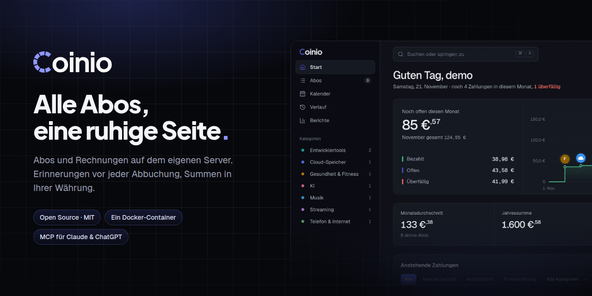
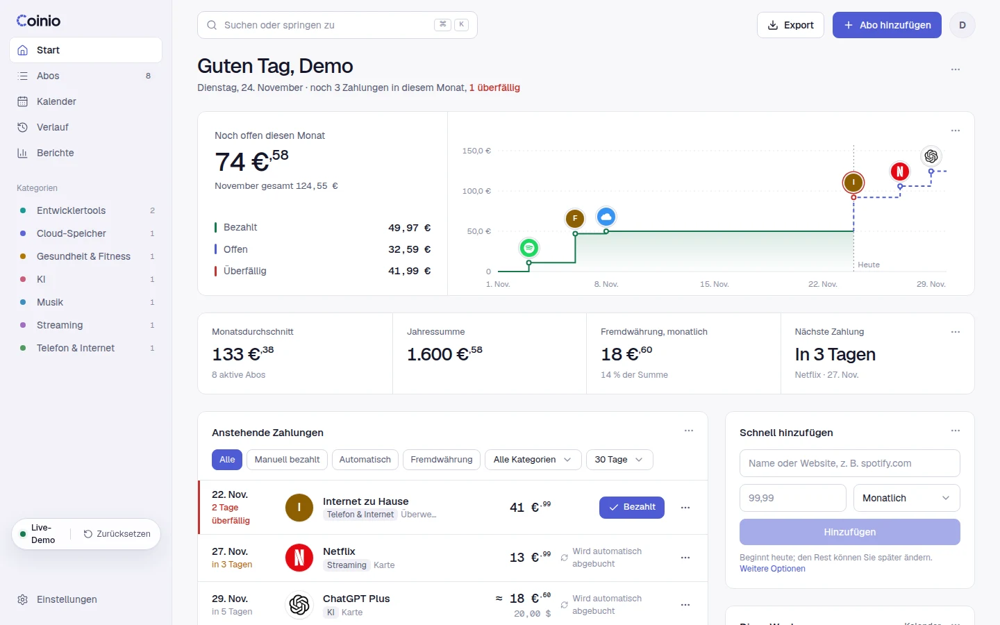
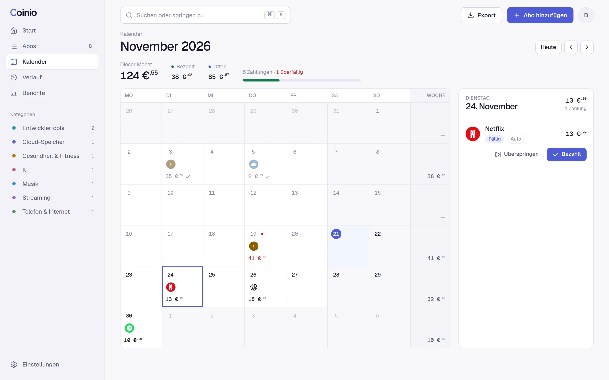
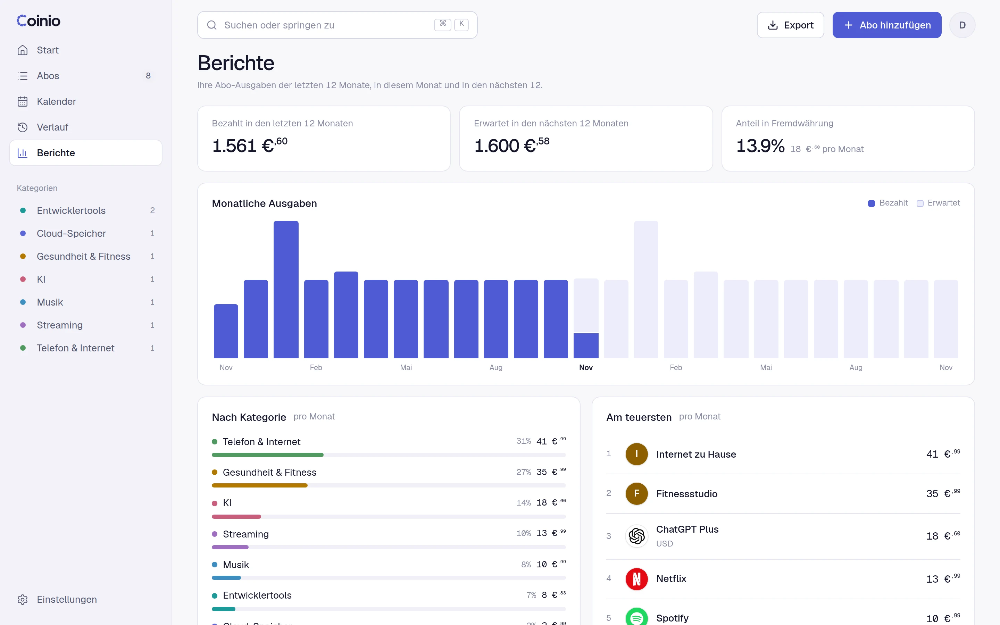
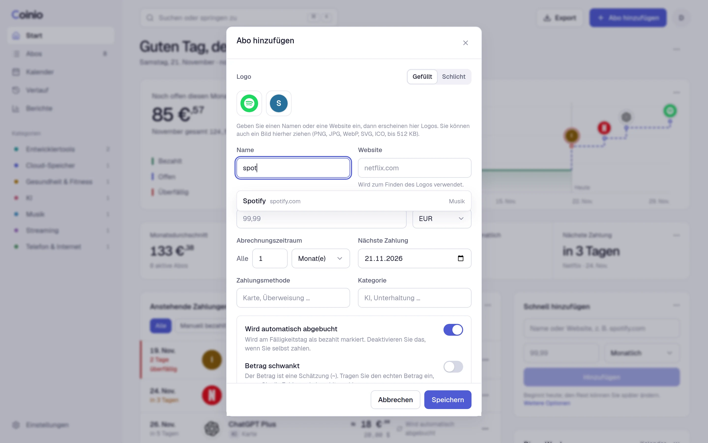
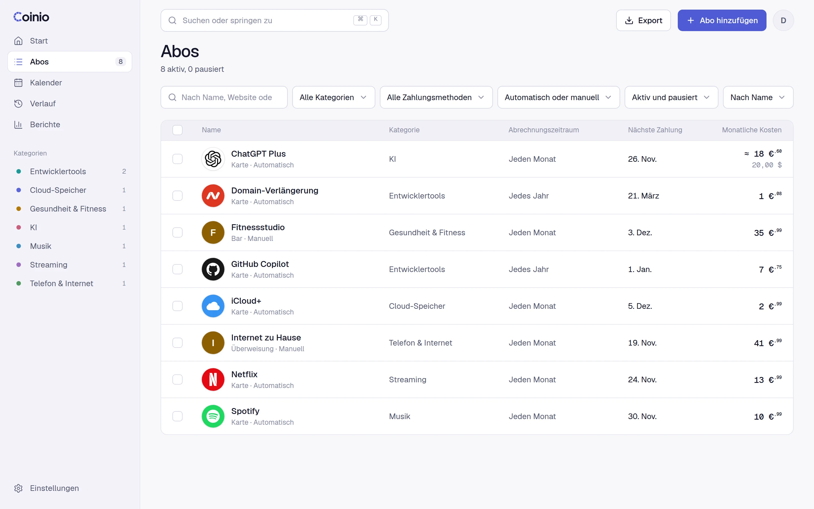
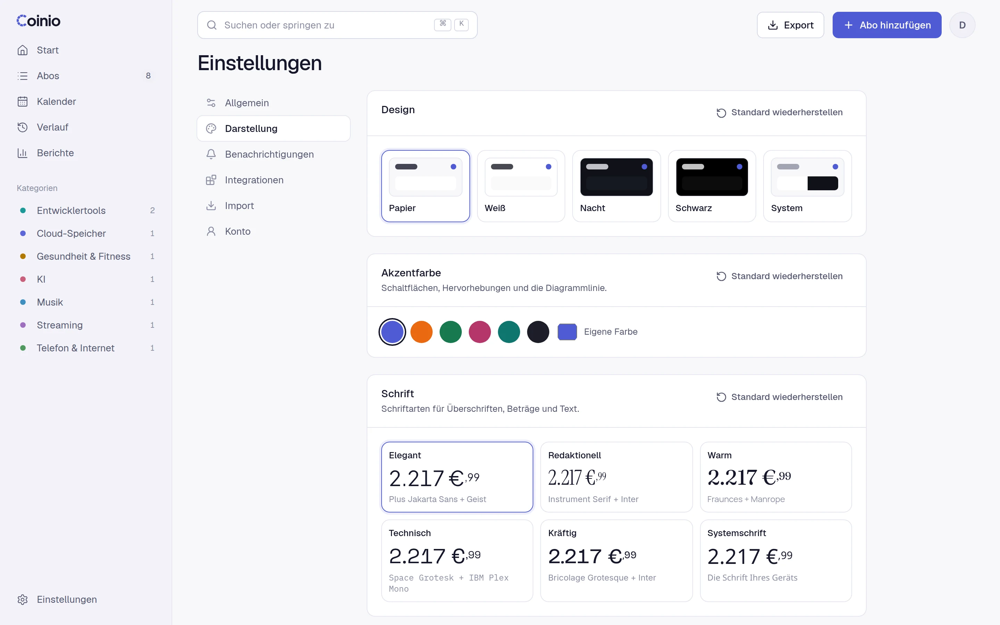
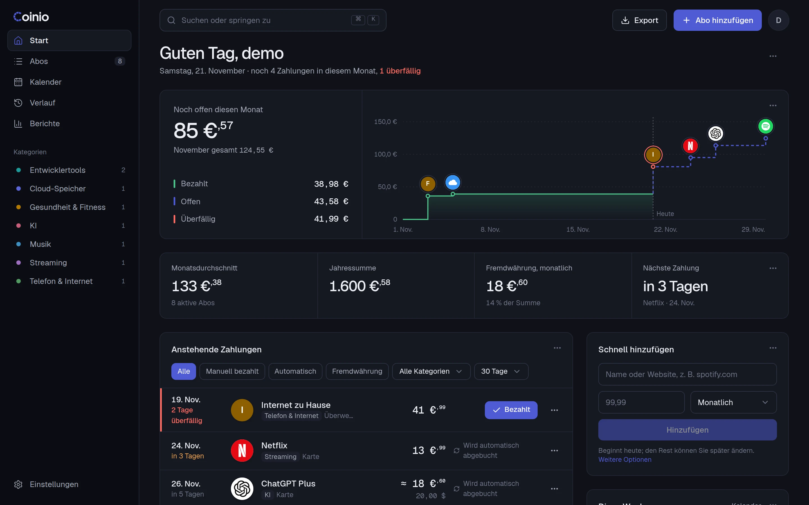
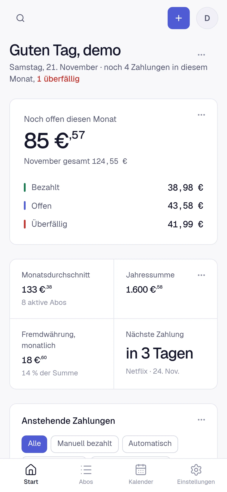

# Coinio

Selbst gehostete Verwaltung für Abos und Rechnungen: ein Docker-Container, ein Datenordner, Ihr Server.

[](https://github.com/yakupemreyerli/coinio/actions/workflows/ci.yml)
[](LICENSE)
[](https://github.com/yakupemreyerli/coinio/pkgs/container/coinio)

[English](README.md) · [Türkçe](README.tr.md) · **Deutsch** · [Français](README.fr.md) · [Español](README.es.md) · [Português (Brasil)](README.pt-BR.md) · [简体中文](README.zh-CN.md) · [日本語](README.ja.md)

[Website](https://getcoinio.me) · [Dokumentation](https://docs.getcoinio.me) · [Live-Demo](https://getcoinio.me/demo/) · [Kostenlos nutzen](https://app.getcoinio.me/signup)



Coinio sammelt jede wiederkehrende Zahlung auf einer Seite: Streaming, Cloud-Speicher, Fitnessstudio, Miete, die Domain, die Sie einmal im Jahr verlängern. Sie sehen, was diese Woche fällig ist, was diesen Monat noch zu zahlen bleibt und was das ganze Jahr kostet, umgerechnet in Ihre Hauptwährung. Es gibt kein Konto auf dem Server eines Fremden, kein Tracking und keine Bezahlversion.

**Erst ausprobieren:** Die [Live-Demo](https://getcoinio.me/demo/) ist die echte Web-App, die mit Beispieldaten in Ihrem Browser läuft. Es wird nichts versendet, und sie lässt sich jederzeit zurücksetzen.

**Lieber nichts installieren?** Nutzen Sie Coinio kostenlos auf [app.getcoinio.me](https://app.getcoinio.me/signup): dieselbe App, keine Werbung, kein Tracking. [Mehr](https://docs.getcoinio.me/docs/hosted)

## Screenshots

<table>
  <tr>
    <td width="50%"><br><sub>Start: was diesen Monat noch zu zahlen bleibt und was als Nächstes fällig ist</sub></td>
    <td width="50%"><br><sub>Kalender: Zahltage und Wochensummen</sub></td>
  </tr>
  <tr>
    <td width="50%"><br><sub>Berichte: 12 Monate zurück, 12 Monate voraus</sub></td>
    <td width="50%"><br><sub>„spot“ tippen, und Spotify füllt sich aus</sub></td>
  </tr>
</table>

<details>
<summary>Weitere Screenshots</summary>
<br>
<table>
  <tr>
    <td width="50%"><br><sub>Alle Abos auf einen Blick</sub></td>
    <td width="50%"><br><sub>Designs, Akzentfarbe und Schriften</sub></td>
  </tr>
  <tr>
    <td width="50%"><br><sub>Nachtdesign</sub></td>
    <td width="50%"><br><sub>Auf dem Handy, als Web-App installierbar</sub></td>
  </tr>
</table>
</details>

## Funktionen

- **Echte Abrechnungszeiträume.** Wöchentlich, monatlich oder jährlich, alle N Zeiträume, automatisch abgebucht oder von Hand bezahlt. Markieren Sie eine Zahlung als bezahlt, überspringen Sie einen Zeitraum oder pausieren Sie ein Abo; der Verlauf bleibt erhalten.
- **161 Dienste eingebaut.** Tippen Sie „spot“, und Spotify wird mit Logo, Kategorie und Abrechnungszeitraum ausgefüllt. Jede andere Website bekommt ihr eigenes Icon.
- **Kalender und Erinnerungen.** Zahltage Monate im Voraus. Erinnerungen, Zusammenfassungen sowie Warnungen zu Testphasen, Budget und Preisen per E-Mail, Telegram, Discord, Slack, ntfy, Gotify, Pushover, Webhooks oder Apprise, mit bearbeitbaren Vorlagen.
- **Jede Währung.** Jedes Abo behält seine eigene Währung; die Summen werden mit tagesaktuellen Wechselkursen umgerechnet.
- **Verlauf und Berichte.** Was Sie in den letzten 12 Monaten gezahlt haben und was in den nächsten 12 zu erwarten ist, nach Kategorie.
- **Import und Export.** Übernehmen Sie Ihre Abos aus Wallos; exportieren Sie Abos und Zahlungen als CSV oder JSON.
- **KI-Assistenten (MCP).** Ein eingebauter MCP-Server mit OAuth, damit Claude, ChatGPT und andere MCP-Clients Ihre Abos lesen und ändern können.
- **iPhone-Widget.** Widgets für Home- und Sperrbildschirm über Scriptable, ganz ohne App aus dem App Store.
- **Ganz nach Ihrem Geschmack.** Designs, Akzentfarbe, Schriften, Dichte, Karten der Startseite, eigenes CSS und HTML-Karten in einer Sandbox.
- **Acht Sprachen:** Englisch, Türkisch, Deutsch, Französisch, Spanisch, brasilianisches Portugiesisch, vereinfachtes Chinesisch und Japanisch. Als Web-App installierbar.

## Installation

Alle Wege nutzen dasselbe Image, `ghcr.io/yakupemreyerli/coinio:latest` (amd64 und arm64). Die App lauscht auf Port **8080** und legt alle Daten in **`/data`** ab. Öffnen Sie danach `http://your-server:8080` und erstellen Sie Ihr Konto.

**Installationsskript:** prüft, ob Docker vorhanden ist, startet Coinio auf Port 8080 und bietet einen Cloudflare Tunnel für https an ([Skript ansehen](site/install.sh)).

```sh
curl -fsSL https://getcoinio.me/install | sh
```

**Docker:**

```sh
docker run -d --name coinio --restart unless-stopped \
  -p 8080:8080 -v coinio-data:/data \
  ghcr.io/yakupemreyerli/coinio:latest
```

**Docker Compose:** Die Daten landen in `./data` neben der Datei; optionale Einstellungen kommen in eine `.env`-Datei.

```sh
mkdir coinio && cd coinio
curl -fsSLO https://raw.githubusercontent.com/yakupemreyerli/coinio/main/docker-compose.yml
docker compose up -d
```

**Plattformen:**

| Plattform | Wie |
| --- | --- |
| Unraid | Vorlage [`deploy/unraid/coinio.xml`](deploy/unraid/coinio.xml) · [Anleitung](https://docs.getcoinio.me/docs/installation/unraid) |
| CasaOS | Compose-Datei [`deploy/casaos/docker-compose.yml`](deploy/casaos/docker-compose.yml) · [Anleitung](https://docs.getcoinio.me/docs/installation/casaos) |
| Portainer | App-Vorlage [`deploy/portainer/template.json`](deploy/portainer/template.json) · [Anleitung](https://docs.getcoinio.me/docs/installation/portainer) |
| Dokploy | Compose-Service aus diesem Repository, `./docker-compose.yml` · [Anleitung](https://docs.getcoinio.me/docs/installation/dokploy) |

Details finden Sie in [deploy/README.md](deploy/README.md) und in der [Installationsdokumentation](https://docs.getcoinio.me/docs/installation).

## Konfiguration

Coinio wird über Umgebungsvariablen konfiguriert. Alles Weitere (Währung, Zeitzone, Sprache, Uhrzeit der Erinnerungen, Darstellung) stellen Sie in der App ein; es wird in der Datenbank gespeichert. Eine leere Variable gilt als nicht gesetzt. Einen Ausgangspunkt bietet [`.env.example`](.env.example).

| Variable | Standard | Wirkung |
| --- | --- | --- |
| `COINIO_PUBLIC_URL` | nicht gesetzt | Die Adresse, unter der Sie Coinio erreichen, z. B. `https://coinio.example.com`. Aktiviert OAuth für entfernte MCP-Clients und sichere Sitzungs-Cookies. Muss `https://` (oder `http://localhost`) sein; bei einer reinen `http://`-Adresse bleibt OAuth aus. |
| `COINIO_TELEGRAM_BOT_TOKEN` | nicht gesetzt | Telegram-Bot-Token. Zusammen mit der Chat-ID wird beim ersten Start ein Telegram-Kanal angelegt; danach verwalten Sie ihn unter **Einstellungen › Benachrichtigungen**. |
| `COINIO_TELEGRAM_CHAT_ID` | nicht gesetzt | Telegram-Chat-ID für diesen Kanal. |
| `COINIO_TELEGRAM_THREAD_ID` | nicht gesetzt | Optionale Themen-ID in einer Forengruppe. |
| `PORT` | `8080` | Port, auf dem der Server im Container lauscht. |
| `COINIO_DATA_DIR` | `/data` | Ordner für die Datenbank (`coinio.db`) und die Logos (`logos/`). |
| `COINIO_WEB_DIR` | eingebaut | Ordner mit der gebauten Web-App; nur in der Entwicklung nützlich. |
| `TZ` | `UTC` | Zeitzone des Containers; stellen Sie Ihre eigene ein, z. B. `Europe/Berlin`. Die Zeitzone, nach der sich „heute“, automatische Zahlungen und Erinnerungen richten, wählen Sie in der App (**Einstellungen › Allgemein**). |

Lassen Sie `PORT` und `COINIO_DATA_DIR` in Docker unverändert: Veröffentlichen Sie stattdessen einen anderen Port (`-p 9000:8080`) oder binden Sie einen anderen Ordner unter `/data` ein. Der Container läuft als Benutzer `node` (UID 1000), ein eingebundener Ordner muss für ihn beschreibbar sein; der Entrypoint übernimmt beim Start Ordner, die root gehören. Vollständige Referenz: [docs.getcoinio.me/docs/reference/configuration](https://docs.getcoinio.me/docs/reference/configuration).

## HTTPS und Fernzugriff

Im Heimnetz oder über ein VPN genügt `http://<server-ip>:8080`. Das iPhone-Widget (unterwegs) und die Konnektoren für claude.ai und ChatGPT brauchen eine öffentliche **https**-Adresse:

- **Cloudflare Tunnel:** Das Installationsskript fragt nach einem Tunnel-Token und startet `cloudflared` neben Coinio, sodass Sie https erhalten, ohne Ports zu öffnen.
- **Reverse Proxy:** Wenn Sie bereits Caddy, Traefik, Nginx oder Dokploy betreiben, richten Sie eine Domain auf Port 8080.

Setzen Sie in beiden Fällen `COINIO_PUBLIC_URL` auf diese https-Adresse. Siehe [Expose to the internet](https://docs.getcoinio.me/docs/expose).

## KI-Assistenten (MCP)

Der MCP-Server liegt unter Ihrer Coinio-Adresse plus `/mcp`. Cloud-Apps wie claude.ai und ChatGPT melden sich per OAuth an (braucht `COINIO_PUBLIC_URL` mit https); Tools auf Ihrem eigenen Rechner verwenden einen API-Schlüssel unter **Einstellungen › Integrationen › API-Schlüssel**. Unter **Einstellungen › Integrationen** finden Sie fertige Snippets. Anleitung: [docs.getcoinio.me/docs/integrations/mcp](https://docs.getcoinio.me/docs/integrations/mcp).

## iPhone-Widget

[`widget/coinio-widget.js`](widget/coinio-widget.js) ist ein [Scriptable](https://scriptable.app)-Skript für kleine, mittlere und große Widgets auf dem Home-Bildschirm sowie für Widgets auf dem Sperrbildschirm. Erstellen Sie einen schreibgeschützten API-Schlüssel, fügen Sie das Skript ein und tragen Sie `SERVER_URL` und `API_KEY` ein. Anleitung: [docs.getcoinio.me/docs/integrations/iphone-widget](https://docs.getcoinio.me/docs/integrations/iphone-widget).

## Aktualisieren

Datenbankmigrationen laufen von selbst, wenn eine neue Version startet.

```sh
# Compose
docker compose pull && docker compose up -d

# docker run: Image laden, Container entfernen, mit demselben Befehl neu starten
docker pull ghcr.io/yakupemreyerli/coinio:latest
docker rm -f coinio
docker run -d --name coinio --restart unless-stopped \
  -p 8080:8080 -v coinio-data:/data \
  ghcr.io/yakupemreyerli/coinio:latest
```

Wenn Sie mit dem Skript installiert haben, führen Sie statt des letzten Befehls das Skript erneut aus.

## Backups

Alles liegt in `/data`: die SQLite-Datenbank (`coinio.db`, WAL-Modus) und die Logos. Sichern Sie diesen Ordner, und Sie haben alles. Beim Installationsskript und bei `docker run` heißt das Volume `coinio-data`:

```sh
docker stop coinio
docker run --rm -v coinio-data:/data -v "$PWD":/backup alpine \
  tar czf /backup/coinio-backup.tar.gz -C /data .
docker start coinio
```

Bei Compose archivieren Sie den Ordner `./data`, während der Container gestoppt ist. Das Backup enthält API-Schlüssel, Benachrichtigungs-Tokens und Sitzungen, bewahren Sie es also wie ein Passwort auf. Abos und Zahlungen lassen sich außerdem in der App als CSV oder JSON exportieren. Schritte zur Wiederherstellung: [docs.getcoinio.me/docs/maintenance](https://docs.getcoinio.me/docs/maintenance).

## Entwicklung

Benötigt Node.js 22 und pnpm 12.

```sh
pnpm install
pnpm dev          # Web auf http://localhost:4660, API auf :4661, Daten in ./.data
pnpm test         # Vitest: Server und Web
pnpm typecheck
pnpm build        # dist/server und dist/web
pnpm build:demo   # Demo, die nur im Browser läuft, nach site/demo/
```

Die Doku-Seite ist ein eigenes Paket: `cd docs-site && pnpm install && pnpm dev`. Alles Weitere steht in [CONTRIBUTING.md](CONTRIBUTING.md).

## Projektstruktur

```text
src/server/     Express-API, SQLite (Drizzle), Authentifizierung, OAuth, MCP-Server, Scheduler, Dienste
src/web/        Web-App mit React + Vite (Routen, Karten der Startseite, Einstellungen, i18n, Demo-Backend)
src/shared/     Gemeinsame Logik von Server, Web und Demo: Zahlungsplan, Katalog, Darstellung, Typen
tests/          Server-Tests (Web-Tests liegen neben ihren Komponenten)
widget/         Scriptable-Widget für das iPhone
deploy/         Vorlagen für Unraid, CasaOS und Portainer
site/           Startseite (getcoinio.me), Installationsskript und die gebaute Demo in site/demo/
docs-site/      Dokumentation (docs.getcoinio.me), Fumadocs auf Next.js
docs/           Markenmaterial und die README-Banner
```

## Danksagung

- Die Markenlogos stammen von [Simple Icons](https://simpleicons.org) (CC0-1.0). Die Logos sind Marken ihrer Inhaber; ihre Verwendung bedeutet keine Empfehlung.
- Hat ein Dienst kein Simple-Icons-Logo, holt Coinio das Icon der Website selbst oder die Favicon-Dienste von Google und DuckDuckGo.
- Wechselkurse von [Frankfurter](https://frankfurter.dev), das die Referenzkurse der Europäischen Zentralbank veröffentlicht.
- Schriften über [Fontsource](https://fontsource.org) und Google Fonts: Geist, Geist Mono, Inter, Manrope, Space Grotesk, Bricolage Grotesque, Fraunces, Instrument Serif, IBM Plex Mono und Plus Jakarta Sans, alle unter der SIL Open Font License 1.1.
- Icons von [Lucide](https://lucide.dev) (ISC). Die Doku-Seite entsteht mit [Fumadocs](https://fumadocs.dev).

## Lizenz

[MIT](LICENSE) © 2026 Yakup Emre Yerli
