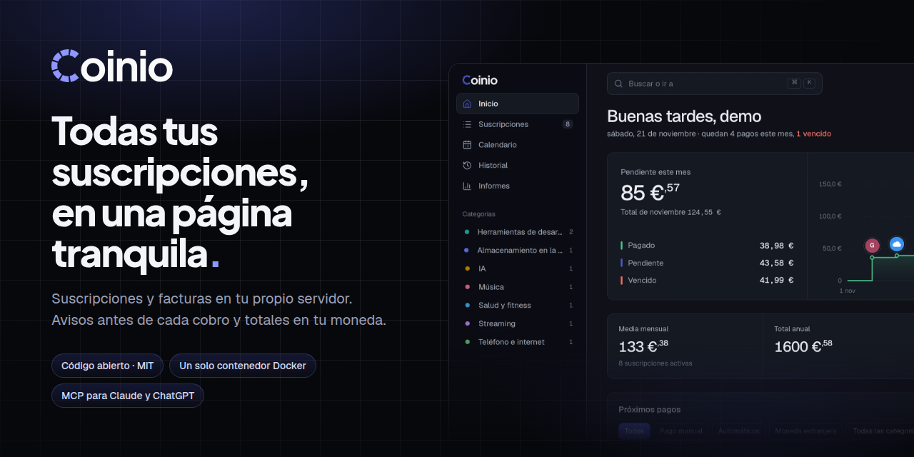
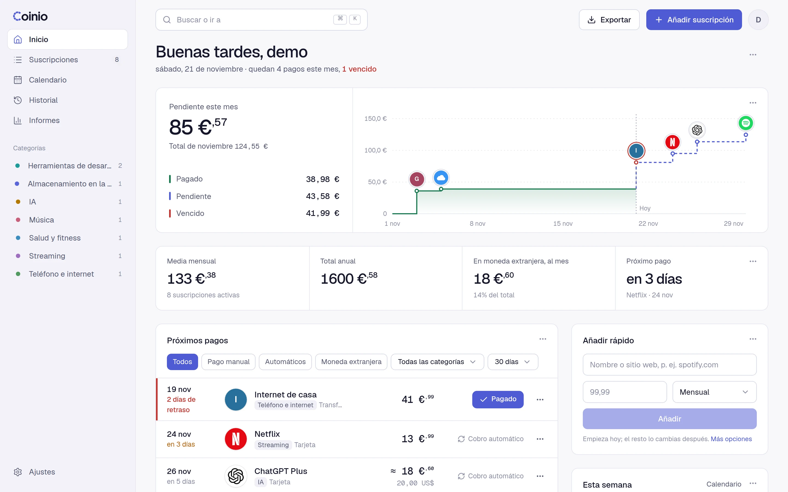
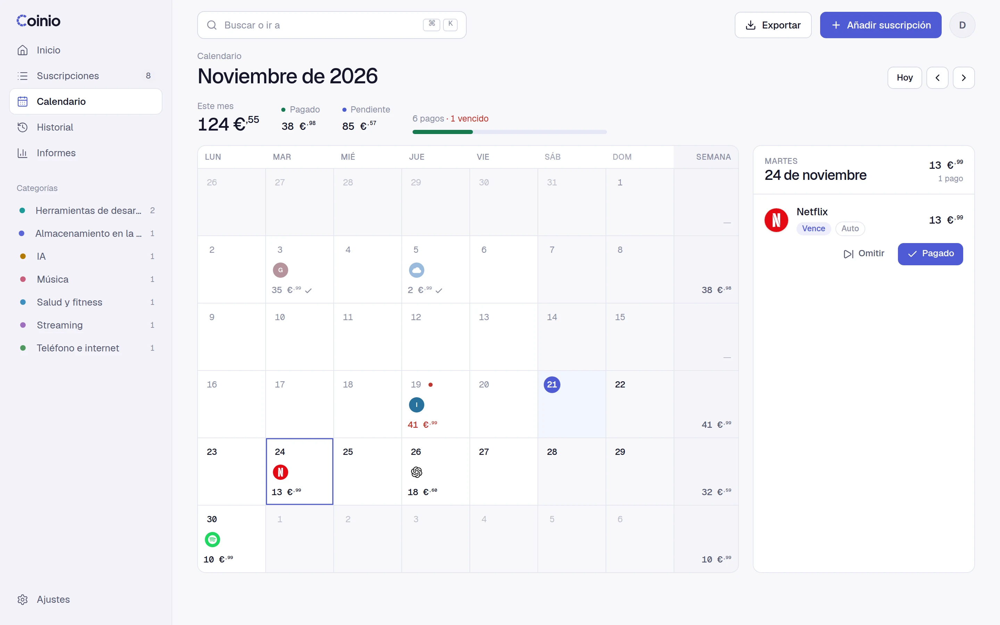
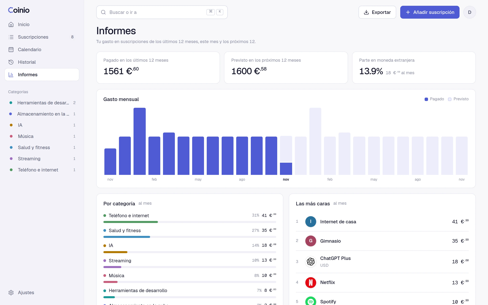
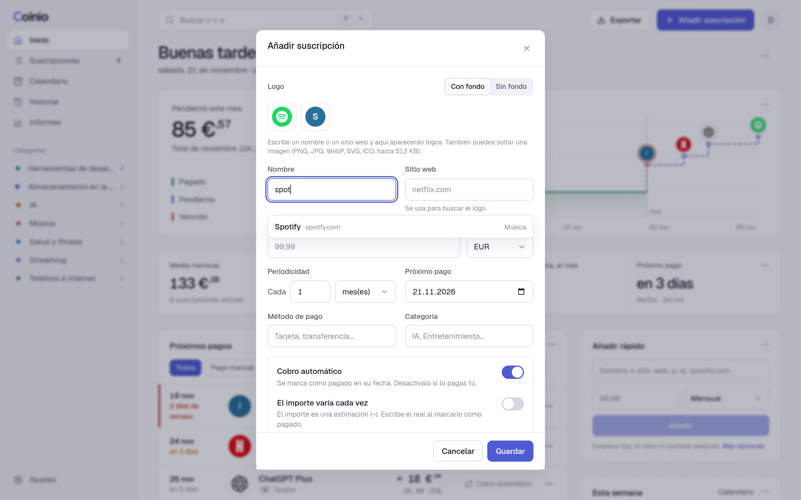
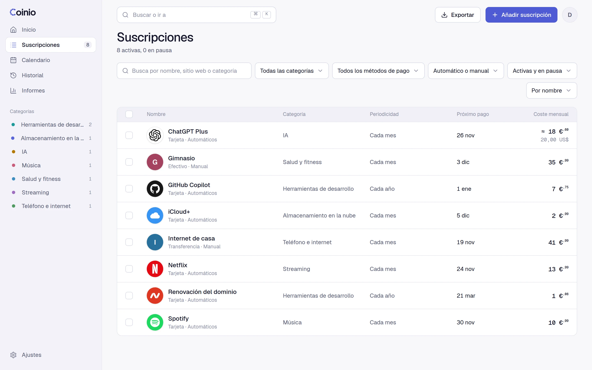
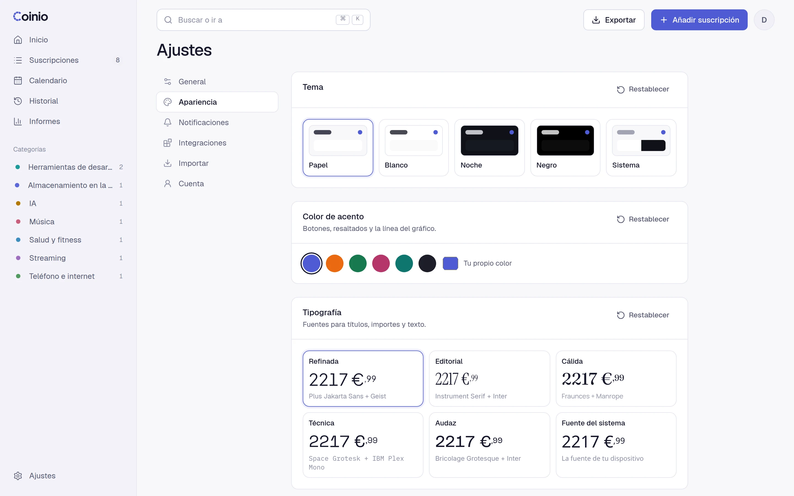
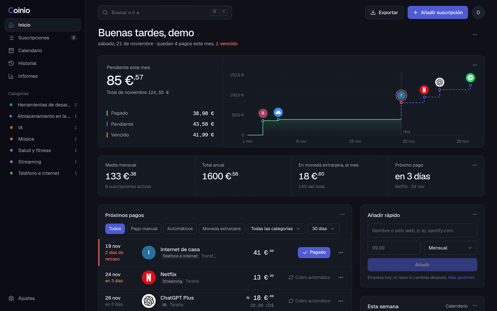
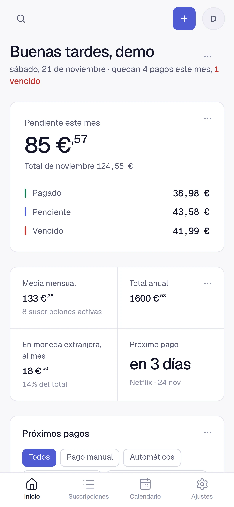

# Coinio

Un gestor de suscripciones y facturas autoalojado: un contenedor Docker, una carpeta de datos, tu servidor.

[](https://github.com/yakupemreyerli/coinio/actions/workflows/ci.yml)
[](LICENSE)
[](https://github.com/yakupemreyerli/coinio/pkgs/container/coinio)

[English](README.md) · [Türkçe](README.tr.md) · [Deutsch](README.de.md) · [Français](README.fr.md) · **Español** · [Português (Brasil)](README.pt-BR.md) · [简体中文](README.zh-CN.md) · [日本語](README.ja.md)

[Web](https://getcoinio.me) · [Documentación](https://docs.getcoinio.me) · [Demo en vivo](https://getcoinio.me/demo/)



Coinio reúne cada pago recurrente en una sola página: streaming, almacenamiento en la nube, el gimnasio, el alquiler, el dominio que renuevas una vez al año. Ves qué vence esta semana, cuánto te queda por pagar este mes y cuánto cuesta el año entero, convertido a tu moneda principal. No hay cuenta en el servidor de otra persona, ni telemetría, ni plan de pago.

**Pruébalo primero:** la [demo en vivo](https://getcoinio.me/demo/) es la app web de verdad, funcionando en tu navegador con datos de ejemplo. No se envía nada a ninguna parte y la restableces cuando quieras.

## Capturas de pantalla

<table>
  <tr>
    <td width="50%"><br><sub>Inicio: lo que queda por pagar este mes y lo que vence a continuación</sub></td>
    <td width="50%"><br><sub>Calendario: días de pago y totales semanales</sub></td>
  </tr>
  <tr>
    <td width="50%"><br><sub>Informes: 12 meses atrás, 12 meses por delante</sub></td>
    <td width="50%"><br><sub>Escribe «spot» y Spotify se rellena</sub></td>
  </tr>
</table>

<details>
<summary>Más capturas de pantalla</summary>
<br>
<table>
  <tr>
    <td width="50%"><br><sub>Todas las suscripciones de un vistazo</sub></td>
    <td width="50%"><br><sub>Temas, color de acento y fuentes</sub></td>
  </tr>
  <tr>
    <td width="50%"><br><sub>Tema nocturno</sub></td>
    <td width="50%"><br><sub>En el móvil, instalable como app web</sub></td>
  </tr>
</table>
</details>

## Características

- **Ciclos de cobro reales.** Semanal, mensual o anual, cada N ciclos, con cobro automático o pago manual. Marca un pago como pagado, salta un periodo o pausa una suscripción; el historial se conserva.
- **161 servicios incluidos.** Escribe «spot» y Spotify se rellena con su logo, su categoría y su periodicidad. Cualquier otra web recibe su propio icono.
- **Calendario y recordatorios.** Los días de pago con meses de antelación. Recordatorios, resúmenes y avisos de prueba gratuita, presupuesto y precio por correo, Telegram, Discord, Slack, ntfy, Gotify, Pushover, webhooks o Apprise, con plantillas editables.
- **Cualquier moneda.** Cada suscripción conserva su propia moneda; los totales se convierten con tipos de cambio diarios.
- **Historial e informes.** Lo que has pagado en los últimos 12 meses y lo que te espera en los próximos 12, por categoría.
- **Importar y exportar.** Trae tus suscripciones desde Wallos; exporta suscripciones y pagos en CSV o JSON.
- **Asistentes de IA (MCP).** Un servidor MCP integrado con OAuth, para que Claude, ChatGPT y otros clientes MCP puedan leer y actualizar tus suscripciones.
- **Widget para iPhone.** Widgets para la pantalla de inicio y la pantalla bloqueada con Scriptable, sin necesidad de una app del App Store.
- **A tu manera.** Temas, color de acento, fuentes, densidad, tarjetas de inicio, CSS propio y tarjetas HTML en un entorno aislado.
- **Ocho idiomas:** inglés, turco, alemán, francés, español, portugués de Brasil, chino simplificado y japonés. Instalable como app web.

## Instalación

Todos los métodos usan la misma imagen, `ghcr.io/yakupemreyerli/coinio:latest` (amd64 y arm64). La app escucha en el puerto **8080** y guarda todos sus datos en **`/data`**. Después abre `http://your-server:8080` y crea tu cuenta.

**Script de instalación:** comprueba que Docker esté instalado, inicia Coinio en el puerto 8080 y te ofrece un Cloudflare Tunnel para tener https ([ver el script](site/install.sh)).

```sh
curl -fsSL https://getcoinio.me/install | sh
```

**Docker:**

```sh
docker run -d --name coinio --restart unless-stopped \
  -p 8080:8080 -v coinio-data:/data \
  ghcr.io/yakupemreyerli/coinio:latest
```

**Docker Compose:** los datos se guardan en `./data`, junto al archivo; los ajustes opcionales van en un archivo `.env`.

```sh
mkdir coinio && cd coinio
curl -fsSLO https://raw.githubusercontent.com/yakupemreyerli/coinio/main/docker-compose.yml
docker compose up -d
```

**Plataformas:**

| Plataforma | Cómo |
| --- | --- |
| Unraid | Plantilla [`deploy/unraid/coinio.xml`](deploy/unraid/coinio.xml) · [guía](https://docs.getcoinio.me/docs/installation/unraid) |
| CasaOS | Archivo Compose [`deploy/casaos/docker-compose.yml`](deploy/casaos/docker-compose.yml) · [guía](https://docs.getcoinio.me/docs/installation/casaos) |
| Portainer | Plantilla de aplicación [`deploy/portainer/template.json`](deploy/portainer/template.json) · [guía](https://docs.getcoinio.me/docs/installation/portainer) |
| Dokploy | Servicio Compose desde este repositorio, `./docker-compose.yml` · [guía](https://docs.getcoinio.me/docs/installation/dokploy) |

Consulta [deploy/README.md](deploy/README.md) y la [documentación de instalación](https://docs.getcoinio.me/docs/installation) para más detalles.

## Configuración

Coinio se configura con variables de entorno. Todo lo demás (moneda, zona horaria, idioma, hora de los recordatorios, apariencia) se ajusta en la app y se guarda en la base de datos. Una variable vacía cuenta como no definida. Tienes un punto de partida en [`.env.example`](.env.example).

| Variable | Valor por defecto | Qué hace |
| --- | --- | --- |
| `COINIO_PUBLIC_URL` | no definida | La dirección con la que accedes a Coinio, p. ej. `https://coinio.example.com`. Activa OAuth para clientes MCP remotos y las cookies de sesión seguras. Debe ser `https://` (o `http://localhost`); con una dirección `http://` simple, OAuth sigue desactivado. |
| `COINIO_TELEGRAM_BOT_TOKEN` | no definida | Token del bot de Telegram. Junto con el ID del chat, crea un canal de Telegram en el primer inicio; después lo gestionas en **Ajustes › Notificaciones**. |
| `COINIO_TELEGRAM_CHAT_ID` | no definida | ID del chat de Telegram para ese canal. |
| `COINIO_TELEGRAM_THREAD_ID` | no definida | ID de tema opcional en un grupo de foro. |
| `PORT` | `8080` | Puerto en el que escucha el servidor dentro del contenedor. |
| `COINIO_DATA_DIR` | `/data` | Carpeta de la base de datos (`coinio.db`) y de los logos (`logos/`). |
| `COINIO_WEB_DIR` | integrada | Carpeta con la app web compilada; solo es útil en desarrollo. |
| `TZ` | `UTC` | Zona horaria del contenedor; pon la tuya, p. ej. `Europe/Madrid`. La zona que siguen «hoy», los pagos automáticos y los recordatorios se elige en la app (**Ajustes › General**). |

En Docker, no toques `PORT` ni `COINIO_DATA_DIR`: publica otro puerto (`-p 9000:8080`) o monta otra carpeta en `/data`. El contenedor se ejecuta como el usuario `node` (UID 1000), así que una carpeta montada debe poder escribirla; el entrypoint se hace cargo al iniciar de las carpetas que pertenecen a root. Referencia completa: [docs.getcoinio.me/docs/reference/configuration](https://docs.getcoinio.me/docs/reference/configuration).

## HTTPS y acceso remoto

En tu red doméstica o con una VPN basta con `http://<ip-del-servidor>:8080`. El widget para iPhone (fuera de casa) y los conectores de claude.ai y ChatGPT necesitan una dirección **https** pública:

- **Cloudflare Tunnel:** el script de instalación te pide un token de túnel e inicia `cloudflared` junto a Coinio, así tienes https sin abrir ningún puerto.
- **Proxy inverso:** si ya usas Caddy, Traefik, Nginx o Dokploy, apunta un dominio al puerto 8080.

En ambos casos, define `COINIO_PUBLIC_URL` con esa dirección https. Consulta [Expose to the internet](https://docs.getcoinio.me/docs/expose).

## Asistentes de IA (MCP)

El servidor MCP está en la dirección de tu Coinio más `/mcp`. Las apps en la nube como claude.ai y ChatGPT inician sesión con OAuth (requiere `COINIO_PUBLIC_URL` en https); las herramientas de tu propio equipo usan una clave de API de **Ajustes › Integraciones › Claves de API**. En **Ajustes › Integraciones** hay fragmentos listos para copiar. Guía: [docs.getcoinio.me/docs/integrations/mcp](https://docs.getcoinio.me/docs/integrations/mcp).

## Widget para iPhone

[`widget/coinio-widget.js`](widget/coinio-widget.js) es un script de [Scriptable](https://scriptable.app) para widgets pequeños, medianos y grandes en la pantalla de inicio, y para widgets en la pantalla bloqueada. Crea una clave de API de solo lectura, pega el script y rellena `SERVER_URL` y `API_KEY`. Guía: [docs.getcoinio.me/docs/integrations/iphone-widget](https://docs.getcoinio.me/docs/integrations/iphone-widget).

## Actualización

Las migraciones de la base de datos se ejecutan solas cuando arranca una versión nueva.

```sh
# Compose
docker compose pull && docker compose up -d

# docker run: descargar la imagen, eliminar el contenedor y volver a iniciarlo con el mismo comando
docker pull ghcr.io/yakupemreyerli/coinio:latest
docker rm -f coinio
docker run -d --name coinio --restart unless-stopped \
  -p 8080:8080 -v coinio-data:/data \
  ghcr.io/yakupemreyerli/coinio:latest
```

Si instalaste con el script, ejecútalo de nuevo en lugar del último comando.

## Copias de seguridad

Todo vive en `/data`: la base de datos SQLite (`coinio.db`, modo WAL) y los logos. Haz una copia de esa carpeta y lo tienes todo. Con el script de instalación o con `docker run`, el volumen es `coinio-data`:

```sh
docker stop coinio
docker run --rm -v coinio-data:/data -v "$PWD":/backup alpine \
  tar czf /backup/coinio-backup.tar.gz -C /data .
docker start coinio
```

Con Compose, archiva la carpeta `./data` mientras el contenedor está parado. La copia contiene claves de API, tokens de notificación y sesiones, así que guárdala como una contraseña. También puedes exportar suscripciones y pagos en CSV o JSON desde la app. Pasos para restaurar: [docs.getcoinio.me/docs/maintenance](https://docs.getcoinio.me/docs/maintenance).

## Desarrollo

Requiere Node.js 22 y pnpm 12.

```sh
pnpm install
pnpm dev          # web en http://localhost:4660, API en :4661, datos en ./.data
pnpm test         # Vitest: servidor y web
pnpm typecheck
pnpm build        # dist/server y dist/web
pnpm build:demo   # demo que funciona solo en el navegador, en site/demo/
```

El sitio de documentación es un paquete aparte: `cd docs-site && pnpm install && pnpm dev`. El resto está en [CONTRIBUTING.md](CONTRIBUTING.md).

## Estructura del proyecto

```text
src/server/     API de Express, SQLite (Drizzle), autenticación, OAuth, servidor MCP, planificador, servicios
src/web/        App web con React + Vite (rutas, tarjetas de inicio, ajustes, i18n, backend de la demo)
src/shared/     Lógica compartida por servidor, web y demo: calendario de pagos, catálogo, apariencia, tipos
tests/          Pruebas del servidor (las pruebas web están junto a sus componentes)
widget/         Widget de Scriptable para iPhone
deploy/         Plantillas de Unraid, CasaOS y Portainer
site/           Página de presentación (getcoinio.me), script de instalación y la demo compilada en site/demo/
docs-site/      Documentación (docs.getcoinio.me), Fumadocs sobre Next.js
docs/           Recursos de marca y los banners del README
```

## Créditos

- Los logos de marcas proceden de [Simple Icons](https://simpleicons.org) (CC0-1.0). Los logos son marcas de sus propietarios; usarlos no implica respaldo alguno.
- Cuando un servicio no tiene logo en Simple Icons, Coinio obtiene el icono de la propia web, o los servicios de favicons de Google y DuckDuckGo.
- Tipos de cambio de [Frankfurter](https://frankfurter.dev), que publica los tipos de referencia del Banco Central Europeo.
- Fuentes a través de [Fontsource](https://fontsource.org) y Google Fonts: Geist, Geist Mono, Inter, Manrope, Space Grotesk, Bricolage Grotesque, Fraunces, Instrument Serif, IBM Plex Mono y Plus Jakarta Sans, todas con la licencia SIL Open Font License 1.1.
- Iconos de [Lucide](https://lucide.dev) (ISC). El sitio de documentación está hecho con [Fumadocs](https://fumadocs.dev).

## Licencia

[MIT](LICENSE) © 2026 Yakup Emre Yerli
