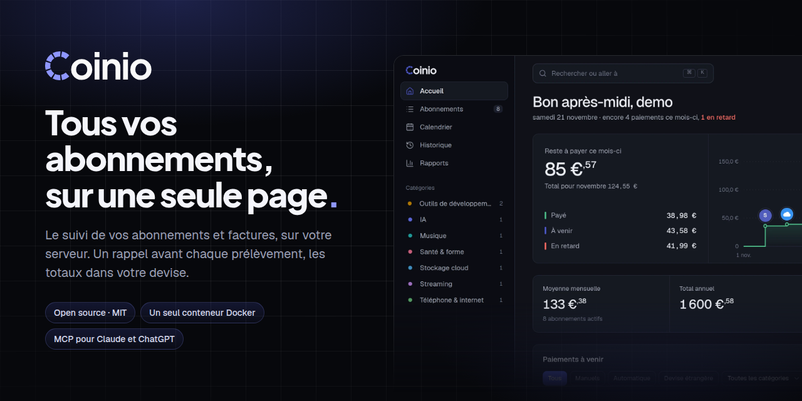
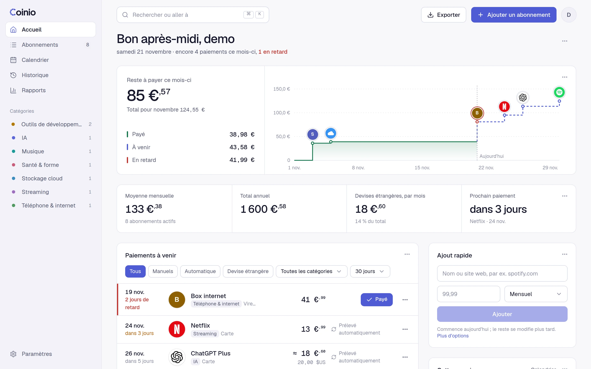
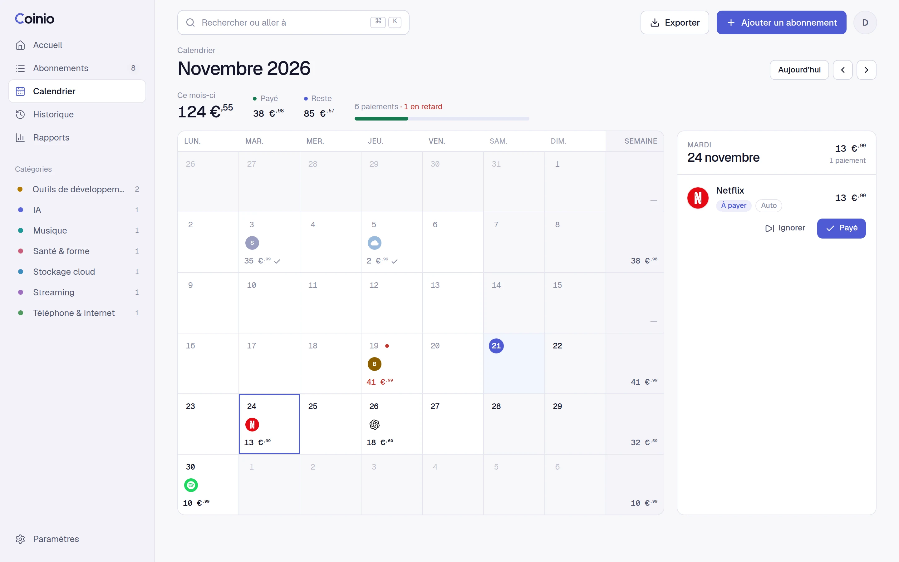
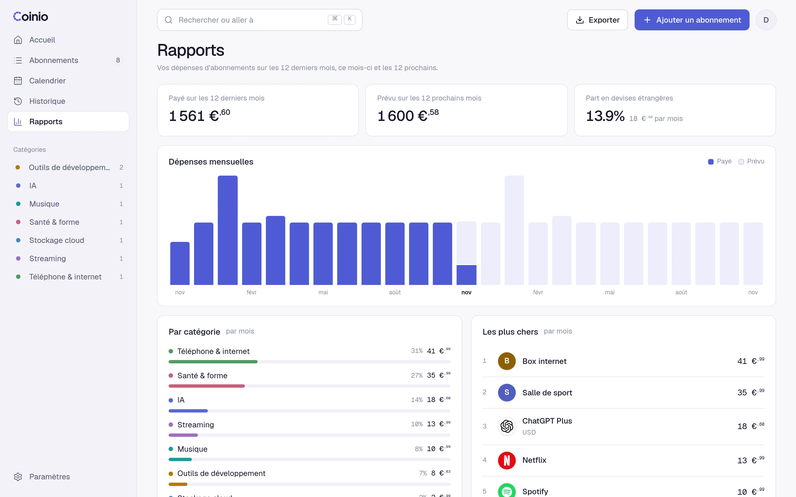
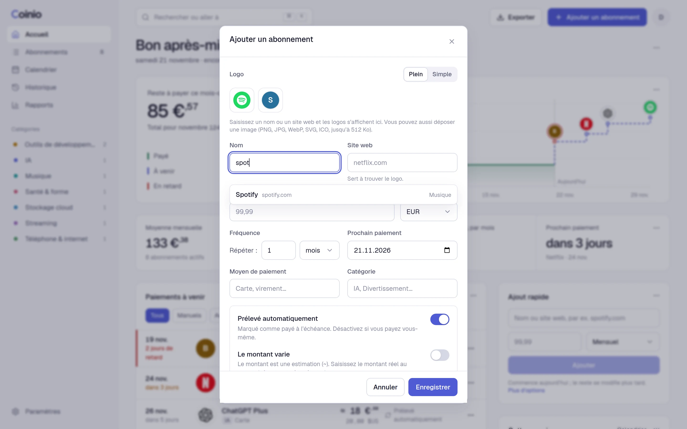
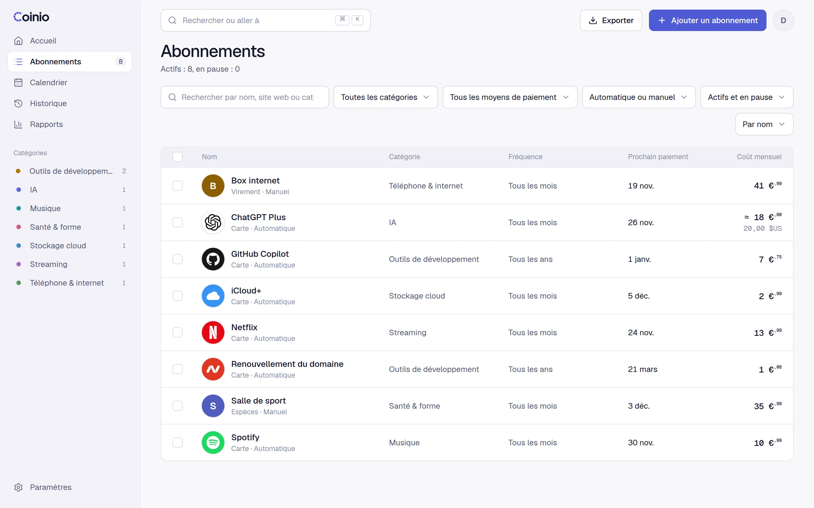
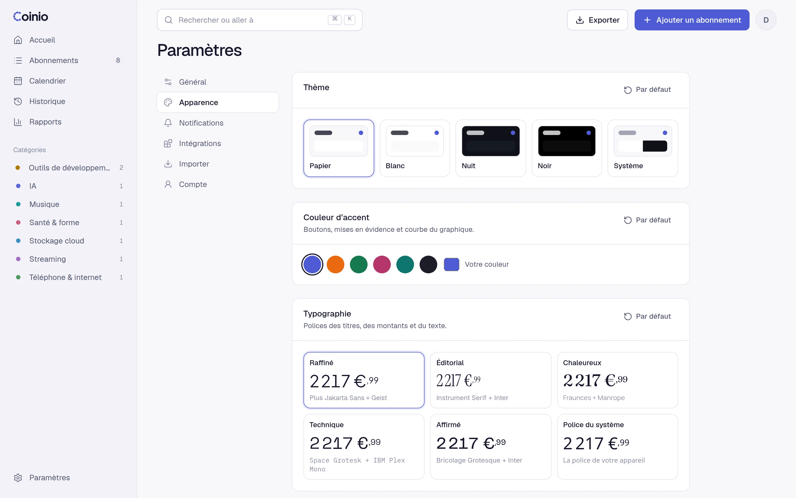
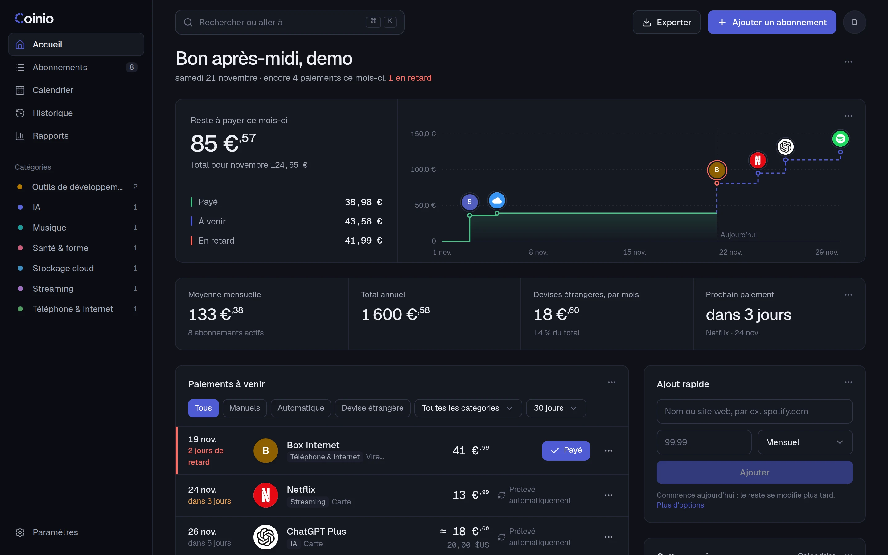
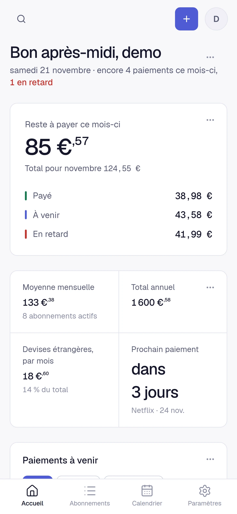

# Coinio

Un gestionnaire d’abonnements et de factures auto-hébergé : un seul conteneur Docker, un seul dossier de données, votre serveur.

[](https://github.com/yakupemreyerli/coinio/actions/workflows/ci.yml)
[](LICENSE)
[](https://github.com/yakupemreyerli/coinio/pkgs/container/coinio)

[English](README.md) · [Türkçe](README.tr.md) · [Deutsch](README.de.md) · **Français** · [Español](README.es.md) · [Português (Brasil)](README.pt-BR.md) · [简体中文](README.zh-CN.md) · [日本語](README.ja.md)

[Site](https://getcoinio.me) · [Documentation](https://docs.getcoinio.me) · [Démo en direct](https://getcoinio.me/demo/)



Coinio réunit chaque paiement récurrent sur une seule page : streaming, stockage cloud, salle de sport, loyer, le nom de domaine que vous renouvelez une fois par an. Vous voyez ce qui arrive à échéance cette semaine, ce qu’il reste à payer ce mois-ci et ce que coûte l’année entière, converti dans votre devise principale. Pas de compte sur le serveur de quelqu’un d’autre, pas de télémétrie et pas d’offre payante.

**Essayez d’abord :** la [démo en direct](https://getcoinio.me/demo/) est la vraie application web, qui tourne dans votre navigateur avec des données d’exemple. Rien n’est envoyé nulle part, et vous la réinitialisez quand vous voulez.

## Captures d’écran

<table>
  <tr>
    <td width="50%"><br><sub>Accueil : ce qu’il reste à payer ce mois-ci et la prochaine échéance</sub></td>
    <td width="50%"><br><sub>Calendrier : jours de paiement et totaux hebdomadaires</sub></td>
  </tr>
  <tr>
    <td width="50%"><br><sub>Rapports : 12 mois en arrière, 12 mois en avant</sub></td>
    <td width="50%"><br><sub>Tapez « spot » et Spotify se remplit</sub></td>
  </tr>
</table>

<details>
<summary>Plus de captures d’écran</summary>
<br>
<table>
  <tr>
    <td width="50%"><br><sub>Tous les abonnements en un coup d’œil</sub></td>
    <td width="50%"><br><sub>Thèmes, couleur d’accent et polices</sub></td>
  </tr>
  <tr>
    <td width="50%"><br><sub>Thème sombre</sub></td>
    <td width="50%"><br><sub>Sur le téléphone, installable comme application web</sub></td>
  </tr>
</table>
</details>

## Fonctionnalités

- **De vrais cycles de facturation.** Hebdomadaire, mensuel ou annuel, tous les N cycles, prélevé automatiquement ou payé à la main. Marquez un paiement comme payé, sautez une période ou mettez un abonnement en pause ; l’historique est conservé.
- **161 services intégrés.** Tapez « spot » et Spotify se remplit avec son logo, sa catégorie et sa fréquence de paiement. Tout autre site obtient sa propre icône.
- **Calendrier et rappels.** Les jours de paiement des mois à l’avance. Rappels, résumés et alertes d’essai, de budget et de prix par e-mail, Telegram, Discord, Slack, ntfy, Gotify, Pushover, webhooks ou Apprise, avec des modèles modifiables.
- **Toutes les devises.** Chaque abonnement garde sa propre devise ; les totaux sont convertis avec les taux de change du jour.
- **Historique et rapports.** Ce que vous avez payé ces 12 derniers mois et ce qui vous attend dans les 12 prochains, par catégorie.
- **Import et export.** Reprenez vos abonnements depuis Wallos ; exportez abonnements et paiements en CSV ou en JSON.
- **Assistants IA (MCP).** Un serveur MCP intégré avec OAuth, pour que Claude, ChatGPT et d’autres clients MCP puissent lire et modifier vos abonnements.
- **Widget iPhone.** Widgets pour l’écran d’accueil et l’écran verrouillé via Scriptable, sans app à installer depuis l’App Store.
- **À votre image.** Thèmes, couleur d’accent, polices, densité, cartes de l’accueil, CSS personnalisé et cartes HTML isolées dans un bac à sable.
- **Huit langues :** anglais, turc, allemand, français, espagnol, portugais du Brésil, chinois simplifié et japonais. Installable comme application web.

## Installation

Toutes les méthodes utilisent la même image, `ghcr.io/yakupemreyerli/coinio:latest` (amd64 et arm64). L’application écoute sur le port **8080** et garde toutes ses données dans **`/data`**. Ouvrez ensuite `http://your-server:8080` et créez votre compte.

**Script d’installation :** vérifie la présence de Docker, lance Coinio sur le port 8080 et propose un Cloudflare Tunnel pour le https ([lire le script](site/install.sh)).

```sh
curl -fsSL https://getcoinio.me/install | sh
```

**Docker :**

```sh
docker run -d --name coinio --restart unless-stopped \
  -p 8080:8080 -v coinio-data:/data \
  ghcr.io/yakupemreyerli/coinio:latest
```

**Docker Compose :** les données sont enregistrées dans `./data`, à côté du fichier ; les réglages facultatifs vont dans un fichier `.env`.

```sh
mkdir coinio && cd coinio
curl -fsSLO https://raw.githubusercontent.com/yakupemreyerli/coinio/main/docker-compose.yml
docker compose up -d
```

**Plateformes :**

| Plateforme | Comment |
| --- | --- |
| Unraid | Modèle [`deploy/unraid/coinio.xml`](deploy/unraid/coinio.xml) · [guide](https://docs.getcoinio.me/docs/installation/unraid) |
| CasaOS | Fichier Compose [`deploy/casaos/docker-compose.yml`](deploy/casaos/docker-compose.yml) · [guide](https://docs.getcoinio.me/docs/installation/casaos) |
| Portainer | Modèle d’application [`deploy/portainer/template.json`](deploy/portainer/template.json) · [guide](https://docs.getcoinio.me/docs/installation/portainer) |
| Dokploy | Service Compose depuis ce dépôt, `./docker-compose.yml` · [guide](https://docs.getcoinio.me/docs/installation/dokploy) |

Voir [deploy/README.md](deploy/README.md) et la [documentation d’installation](https://docs.getcoinio.me/docs/installation) pour les détails.

## Configuration

Coinio se configure avec des variables d’environnement. Tout le reste (devise, fuseau horaire, langue, heure des rappels, apparence) se règle dans l’application et est enregistré dans la base de données. Une variable vide compte comme non définie. Un point de départ se trouve dans [`.env.example`](.env.example).

| Variable | Valeur par défaut | Rôle |
| --- | --- | --- |
| `COINIO_PUBLIC_URL` | non définie | L’adresse à laquelle vous joignez Coinio, par ex. `https://coinio.example.com`. Active OAuth pour les clients MCP distants et les cookies de session sécurisés. Doit être en `https://` (ou `http://localhost`) ; avec une simple adresse `http://`, OAuth reste désactivé. |
| `COINIO_TELEGRAM_BOT_TOKEN` | non définie | Jeton du bot Telegram. Avec l’ID du chat, crée un canal Telegram au premier démarrage ; vous le gérez ensuite dans **Paramètres › Notifications**. |
| `COINIO_TELEGRAM_CHAT_ID` | non définie | ID du chat Telegram pour ce canal. |
| `COINIO_TELEGRAM_THREAD_ID` | non définie | ID de sujet facultatif dans un groupe de forum. |
| `PORT` | `8080` | Port sur lequel le serveur écoute à l’intérieur du conteneur. |
| `COINIO_DATA_DIR` | `/data` | Dossier de la base de données (`coinio.db`) et des logos (`logos/`). |
| `COINIO_WEB_DIR` | intégré | Dossier de l’application web compilée ; utile seulement en développement. |
| `TZ` | `UTC` | Fuseau horaire du conteneur ; indiquez le vôtre, par ex. `Europe/Paris`. Le fuseau que suivent « aujourd’hui », les paiements automatiques et les rappels se choisit dans l’application (**Paramètres › Général**). |

Dans Docker, ne touchez ni à `PORT` ni à `COINIO_DATA_DIR` : publiez plutôt un autre port (`-p 9000:8080`) ou montez un autre dossier sur `/data`. Le conteneur s’exécute avec l’utilisateur `node` (UID 1000) ; un dossier monté doit donc lui être accessible en écriture, et l’entrypoint reprend au démarrage les dossiers appartenant à root. Référence complète : [docs.getcoinio.me/docs/reference/configuration](https://docs.getcoinio.me/docs/reference/configuration).

## HTTPS et accès à distance

Sur votre réseau local ou via un VPN, `http://<ip-du-serveur>:8080` suffit. Le widget iPhone (hors de chez vous) et les connecteurs claude.ai / ChatGPT ont besoin d’une adresse **https** publique :

- **Cloudflare Tunnel :** le script d’installation demande un jeton de tunnel et lance `cloudflared` à côté de Coinio ; vous obtenez le https sans ouvrir aucun port.
- **Reverse proxy :** si vous utilisez déjà Caddy, Traefik, Nginx ou Dokploy, faites pointer un domaine vers le port 8080.

Dans les deux cas, définissez `COINIO_PUBLIC_URL` avec cette adresse https. Voir [Expose to the internet](https://docs.getcoinio.me/docs/expose).

## Assistants IA (MCP)

Le serveur MCP se trouve à l’adresse de votre Coinio suivie de `/mcp`. Les applications cloud comme claude.ai et ChatGPT se connectent avec OAuth (nécessite `COINIO_PUBLIC_URL` en https) ; les outils sur votre propre machine utilisent une clé API créée dans **Paramètres › Intégrations › Clés API**. **Paramètres › Intégrations** propose des extraits prêts à copier. Guide : [docs.getcoinio.me/docs/integrations/mcp](https://docs.getcoinio.me/docs/integrations/mcp).

## Widget iPhone

[`widget/coinio-widget.js`](widget/coinio-widget.js) est un script [Scriptable](https://scriptable.app) pour des widgets petits, moyens et grands sur l’écran d’accueil, ainsi que pour l’écran verrouillé. Créez une clé API en lecture seule, collez le script et renseignez `SERVER_URL` et `API_KEY`. Guide : [docs.getcoinio.me/docs/integrations/iphone-widget](https://docs.getcoinio.me/docs/integrations/iphone-widget).

## Mise à jour

Les migrations de la base de données s’exécutent d’elles-mêmes au démarrage d’une nouvelle version.

```sh
# Compose
docker compose pull && docker compose up -d

# docker run : récupérer l’image, supprimer le conteneur, le relancer avec la même commande
docker pull ghcr.io/yakupemreyerli/coinio:latest
docker rm -f coinio
docker run -d --name coinio --restart unless-stopped \
  -p 8080:8080 -v coinio-data:/data \
  ghcr.io/yakupemreyerli/coinio:latest
```

Si vous avez installé avec le script, relancez-le au lieu de la dernière commande.

## Sauvegardes

Tout se trouve dans `/data` : la base SQLite (`coinio.db`, mode WAL) et les logos. Sauvegardez ce dossier et vous avez tout. Avec le script d’installation ou `docker run`, le volume s’appelle `coinio-data` :

```sh
docker stop coinio
docker run --rm -v coinio-data:/data -v "$PWD":/backup alpine \
  tar czf /backup/coinio-backup.tar.gz -C /data .
docker start coinio
```

Avec Compose, archivez le dossier `./data` pendant que le conteneur est arrêté. La sauvegarde contient des clés API, des jetons de notification et des sessions : conservez-la comme un mot de passe. Vous pouvez aussi exporter abonnements et paiements en CSV ou en JSON depuis l’application. Étapes de restauration : [docs.getcoinio.me/docs/maintenance](https://docs.getcoinio.me/docs/maintenance).

## Développement

Nécessite Node.js 22 et pnpm 12.

```sh
pnpm install
pnpm dev          # web sur http://localhost:4660, API sur :4661, données dans ./.data
pnpm test         # Vitest : serveur et web
pnpm typecheck
pnpm build        # dist/server et dist/web
pnpm build:demo   # démo qui tourne uniquement dans le navigateur, dans site/demo/
```

Le site de documentation est un paquet séparé : `cd docs-site && pnpm install && pnpm dev`. Le reste se trouve dans [CONTRIBUTING.md](CONTRIBUTING.md).

## Structure du projet

```text
src/server/     API Express, SQLite (Drizzle), authentification, OAuth, serveur MCP, planificateur, services
src/web/        Application web React + Vite (routes, cartes de l’accueil, paramètres, i18n, backend de la démo)
src/shared/     Logique commune au serveur, au web et à la démo : échéancier, catalogue, apparence, types
tests/          Tests du serveur (les tests web sont à côté de leurs composants)
widget/         Widget iPhone Scriptable
deploy/         Modèles Unraid, CasaOS et Portainer
site/           Page d’accueil (getcoinio.me), script d’installation et démo compilée dans site/demo/
docs-site/      Documentation (docs.getcoinio.me), Fumadocs sur Next.js
docs/           Éléments de marque et bannières du README
```

## Crédits

- Les logos de marques proviennent de [Simple Icons](https://simpleicons.org) (CC0-1.0). Ces logos sont des marques déposées de leurs propriétaires ; leur utilisation n’implique aucun parrainage.
- Quand un service n’a pas de logo Simple Icons, Coinio récupère l’icône du site lui-même, ou les services de favicons de Google et de DuckDuckGo.
- Taux de change de [Frankfurter](https://frankfurter.dev), qui publie les taux de référence de la Banque centrale européenne.
- Polices via [Fontsource](https://fontsource.org) et Google Fonts : Geist, Geist Mono, Inter, Manrope, Space Grotesk, Bricolage Grotesque, Fraunces, Instrument Serif, IBM Plex Mono et Plus Jakarta Sans, toutes sous licence SIL Open Font License 1.1.
- Icônes de [Lucide](https://lucide.dev) (ISC). Le site de documentation est construit avec [Fumadocs](https://fumadocs.dev).

## Licence

[MIT](LICENSE) © 2026 Yakup Emre Yerli
