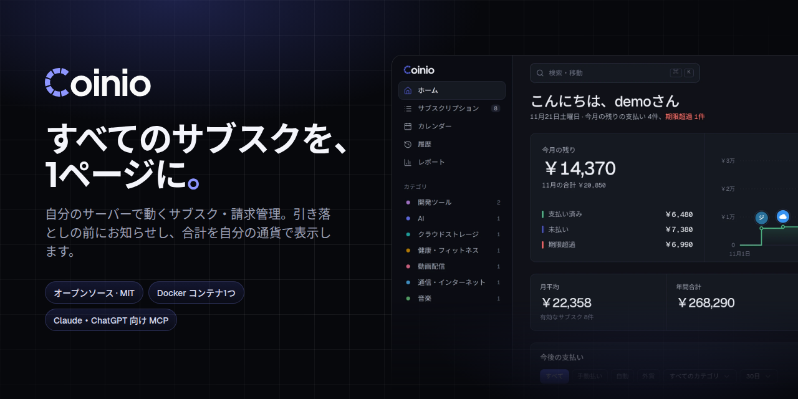
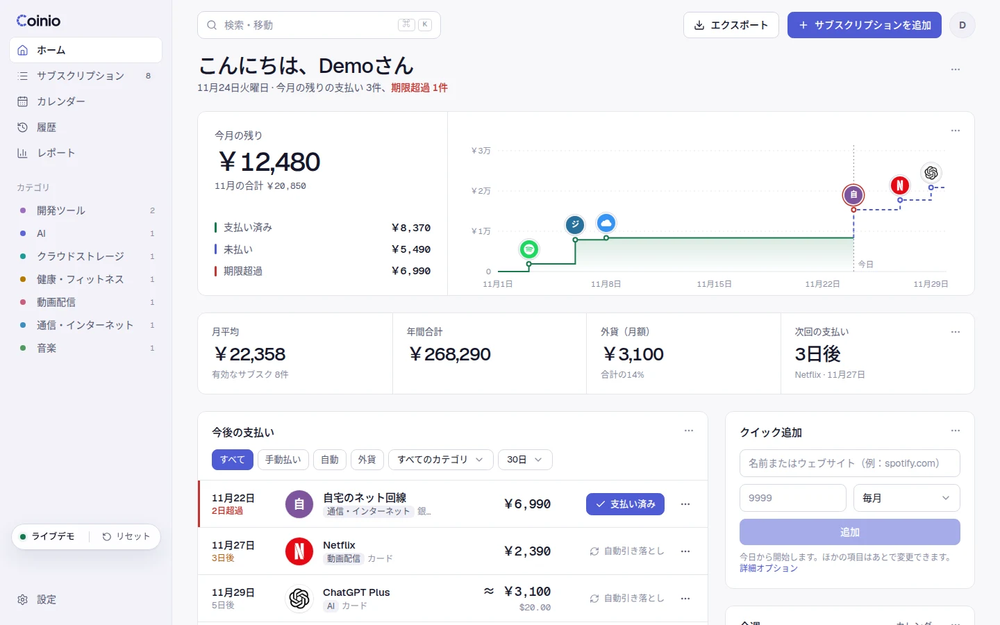
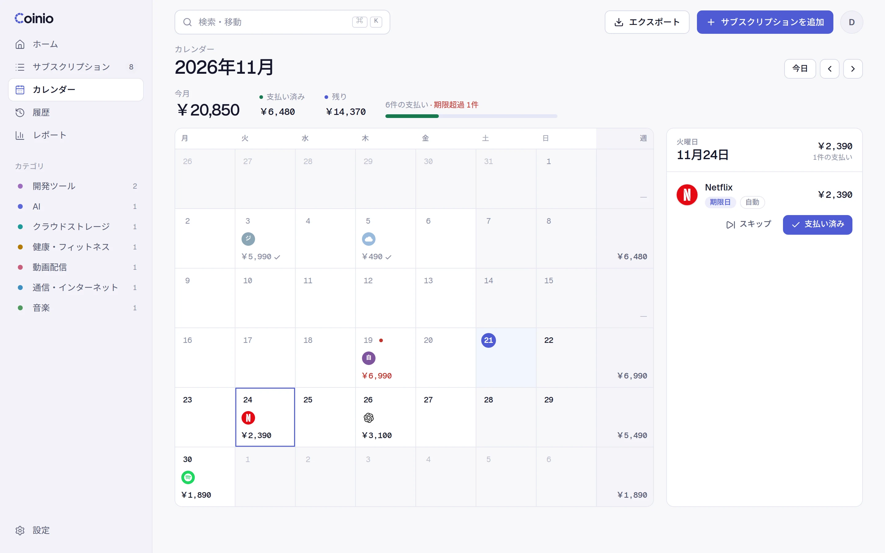
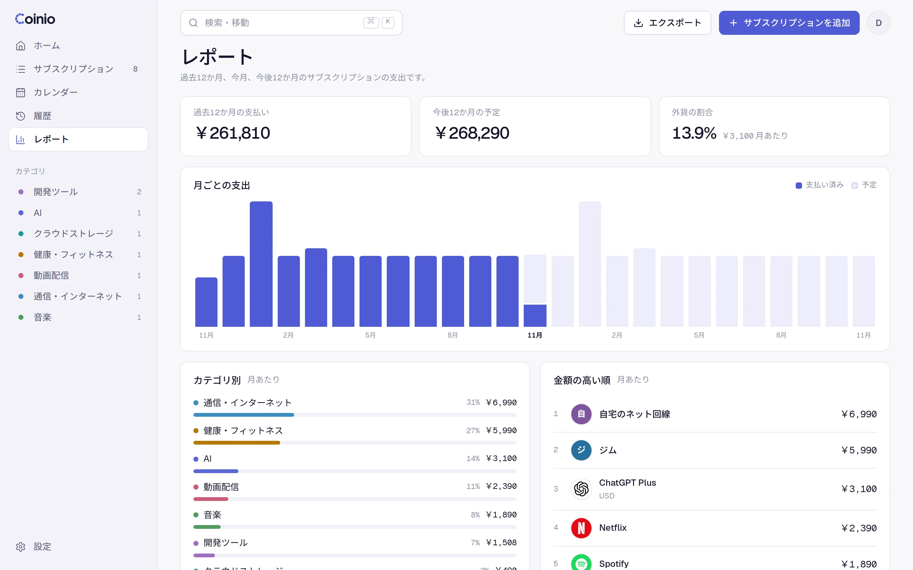
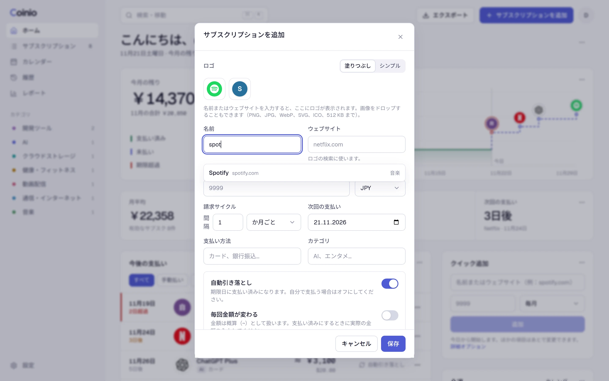
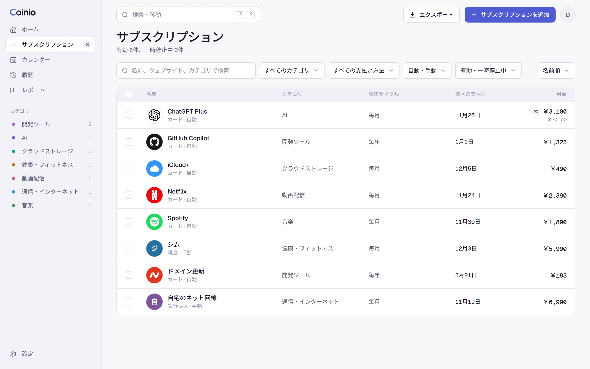
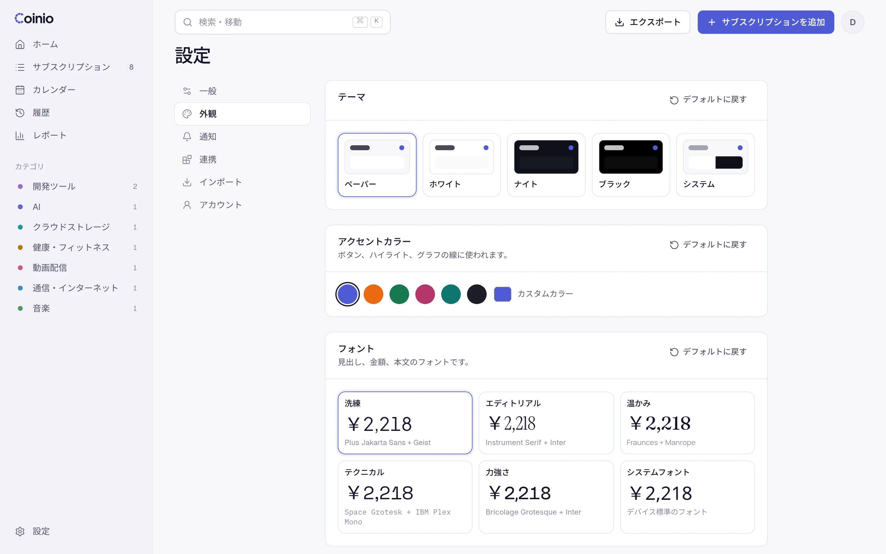
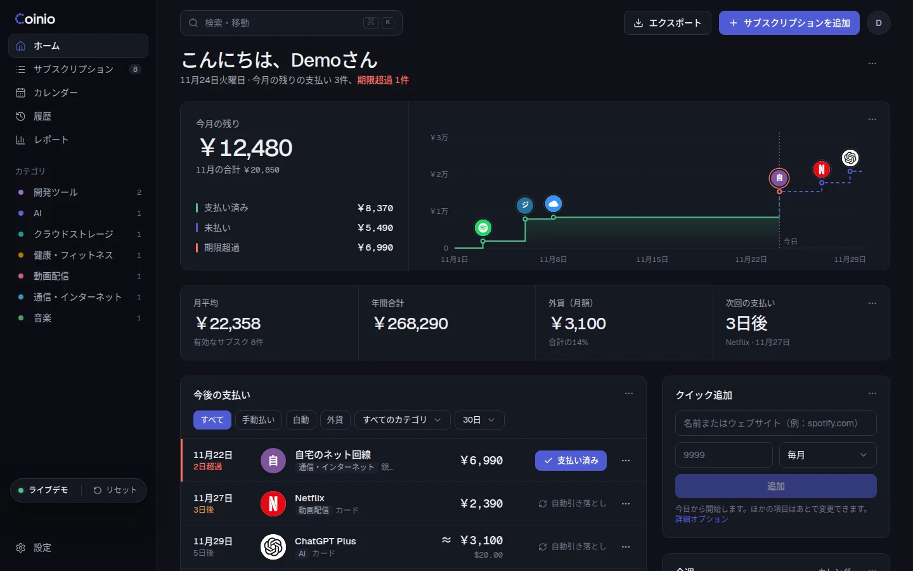
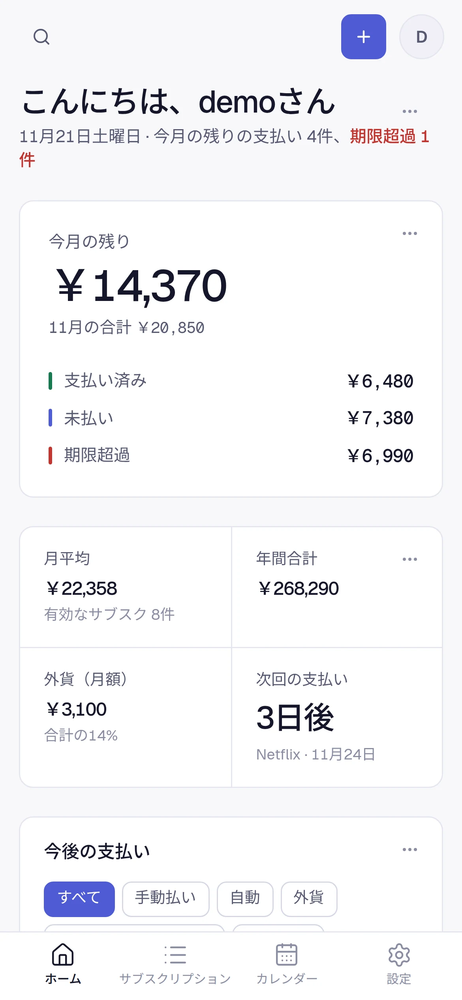

# Coinio

セルフホストできるサブスクリプション・支払い管理アプリ。Docker コンテナ1つ、データフォルダ1つ、動かすのは自分のサーバー。

[](https://github.com/getcoinio/coinio/actions/workflows/ci.yml)
[](LICENSE)
[](https://github.com/getcoinio/coinio/pkgs/container/coinio)

[English](README.md) · [Türkçe](README.tr.md) · [Deutsch](README.de.md) · [Français](README.fr.md) · [Español](README.es.md) · [Português (Brasil)](README.pt-BR.md) · [简体中文](README.zh-CN.md) · **日本語**

[ウェブサイト](https://getcoinio.me) · [ドキュメント](https://docs.getcoinio.me) · [ライブデモ](https://getcoinio.me/demo/) · [無料で使う](https://app.getcoinio.me/signup)



Coinio は、定期的な支払いをすべて1つのページにまとめます。動画配信、クラウドストレージ、ジム、家賃、年に1回更新するドメイン。今週の支払い、今月の残り、1年間の合計金額が、メインの通貨に換算されてひと目でわかります。他人のサーバーにアカウントを作る必要はなく、テレメトリーも有料プランもありません。

**まずは試してみる:** [ライブデモ](https://getcoinio.me/demo/)は、本物の Web アプリをブラウザ内でサンプルデータを使って動かしたものです。データはどこにも送信されず、いつでもリセットできます。

**インストールしたくない場合は** [app.getcoinio.me](https://app.getcoinio.me/signup) で Coinio を無料で使えます。同じアプリで、広告もトラッキングもありません。[詳しく](https://docs.getcoinio.me/docs/hosted)

## スクリーンショット

<table>
  <tr>
    <td width="50%"><br><sub>ホーム: 今月の残りの支払いと、次の支払い</sub></td>
    <td width="50%"><br><sub>カレンダー: 支払い日と週ごとの合計</sub></td>
  </tr>
  <tr>
    <td width="50%"><br><sub>レポート: 過去12か月と今後12か月</sub></td>
    <td width="50%"><br><sub>「spot」と入力すると Spotify が自動で入る</sub></td>
  </tr>
</table>

<details>
<summary>その他のスクリーンショット</summary>
<br>
<table>
  <tr>
    <td width="50%"><br><sub>すべてのサブスクがひと目でわかる</sub></td>
    <td width="50%"><br><sub>テーマ、アクセントカラー、フォント</sub></td>
  </tr>
  <tr>
    <td width="50%"><br><sub>ナイトテーマ</sub></td>
    <td width="50%"><br><sub>スマートフォンで表示。Web アプリとしてインストール可能</sub></td>
  </tr>
</table>
</details>

## 機能

- **本物の請求サイクル。** 毎週、毎月、毎年、N サイクルごと。自動で引き落とされるものも、手動で払うものも扱えます。支払いを支払い済みにする、1期分をスキップする、サブスクを一時停止する。履歴は残ります。
- **161のサービスを内蔵。** 「spot」と入力すれば、Spotify のロゴ、カテゴリ、請求サイクルが自動で入ります。それ以外のサイトは、そのサイト自身のアイコンを使います。
- **カレンダーとリマインダー。** 数か月先まで支払い日を確認できます。リマインダー、ダイジェスト、無料トライアル・予算・価格のアラートを、メール、Telegram、Discord、Slack、ntfy、Gotify、Pushover、Webhook、Apprise で通知。テンプレートは編集できます。
- **どの通貨でも。** サブスクごとに自分の通貨を保持し、合計は毎日の為替レートで換算します。
- **履歴とレポート。** 過去12か月に支払った額と、今後12か月の見込みを、カテゴリ別に確認できます。
- **インポートとエクスポート。** Wallos からサブスクを移行できます。サブスクと支払いは CSV または JSON でエクスポートできます。
- **Firefly III。** 自分の [Firefly III](https://docs.getcoinio.me/docs/integrations/firefly) と双方向に同期。サブスクは請求（bill）になり、支払いも双方向に反映されます。
- **AI アシスタント（MCP）。** OAuth 対応の MCP サーバーを内蔵。Claude、ChatGPT などの MCP クライアントが、サブスクを読み取ったり更新したりできます。
- **iPhone ウィジェット。** Scriptable を使ったホーム画面とロック画面のウィジェット。App Store のアプリは不要です。
- **自分好みの見た目。** テーマ、アクセントカラー、フォント、表示密度、ダッシュボードのカード、独自 CSS、サンドボックス化された HTML カード。
- **8つの言語:** 英語、トルコ語、ドイツ語、フランス語、スペイン語、ポルトガル語（ブラジル）、簡体字中国語、日本語。Web アプリとしてインストールできます。

## インストール

どの方法でも同じイメージ `ghcr.io/getcoinio/coinio:latest`（amd64 と arm64）が動きます。アプリはポート **8080** で待ち受け、データはすべて **`/data`** に保存します。起動したら `http://your-server:8080` を開いて、アカウントを作成してください。

**インストールスクリプト:** Docker の有無を確認し、ポート 8080 で Coinio を起動します。https 用に Cloudflare Tunnel の設定も案内します（[スクリプトを読む](https://github.com/getcoinio/website/blob/main/public/install.sh)）。

```sh
curl -fsSL https://getcoinio.me/install | sh
```

**Docker:**

```sh
docker run -d --name coinio --restart unless-stopped \
  -p 8080:8080 -v coinio-data:/data \
  ghcr.io/getcoinio/coinio:latest
```

**Docker Compose:** データはファイルと同じ場所の `./data` に保存されます。任意の設定は `.env` ファイルに書きます。

```sh
mkdir coinio && cd coinio
curl -fsSLO https://raw.githubusercontent.com/getcoinio/coinio/main/docker-compose.yml
docker compose up -d
```

**プラットフォーム:**

| プラットフォーム | 方法 |
| --- | --- |
| Unraid | テンプレート [`deploy/unraid/coinio.xml`](deploy/unraid/coinio.xml) · [ガイド](https://docs.getcoinio.me/docs/installation/unraid) |
| CasaOS | Compose ファイル [`deploy/casaos/docker-compose.yml`](deploy/casaos/docker-compose.yml) · [ガイド](https://docs.getcoinio.me/docs/installation/casaos) |
| Portainer | アプリテンプレート [`deploy/portainer/template.json`](deploy/portainer/template.json) · [ガイド](https://docs.getcoinio.me/docs/installation/portainer) |
| Dokploy | このリポジトリの Compose サービス、`./docker-compose.yml` · [ガイド](https://docs.getcoinio.me/docs/installation/dokploy) |

詳しくは [deploy/README.md](deploy/README.md) と[インストールのドキュメント](https://docs.getcoinio.me/docs/installation)をご覧ください。

## 設定

Coinio は環境変数で設定します。それ以外（通貨、タイムゾーン、言語、リマインダーの時刻、外観）はアプリ内で設定し、データベースに保存されます。空の変数は未設定として扱われます。出発点として [`.env.example`](.env.example) を用意しています。

| 変数 | デフォルト | 内容 |
| --- | --- | --- |
| `COINIO_PUBLIC_URL` | 未設定 | Coinio にアクセスするアドレス。例: `https://coinio.example.com`。リモートの MCP クライアント向けの OAuth と、安全なセッション Cookie が有効になります。`https://`（または `http://localhost`）である必要があり、単なる `http://` のアドレスでは OAuth は無効のままです。 |
| `COINIO_TELEGRAM_BOT_TOKEN` | 未設定 | Telegram ボットのトークン。チャット ID と合わせて指定すると、初回起動時に Telegram チャンネルが作られます。以降は **設定 › 通知** で管理します。 |
| `COINIO_TELEGRAM_CHAT_ID` | 未設定 | そのチャンネル用の Telegram チャット ID。 |
| `COINIO_TELEGRAM_THREAD_ID` | 未設定 | 任意。フォーラム形式のグループにあるトピックの ID。 |
| `PORT` | `8080` | コンテナ内でサーバーが待ち受けるポート。 |
| `COINIO_DATA_DIR` | `/data` | データベース（`coinio.db`）とロゴ（`logos/`）を置くフォルダ。 |
| `COINIO_WEB_DIR` | 内蔵 | ビルド済み Web アプリのフォルダ。開発時にのみ使います。 |
| `TZ` | `UTC` | コンテナのタイムゾーン。`Europe/Berlin` のように自分のものを指定してください。「今日」、自動引き落とし、リマインダーが従うタイムゾーンは、アプリ内（**設定 › 一般**）で選びます。 |

Docker では `PORT` と `COINIO_DATA_DIR` は変更せず、別のポートを公開する（`-p 9000:8080`）か、別のフォルダを `/data` にマウントしてください。コンテナはユーザー `node`（UID 1000）で動くため、マウントするフォルダはこのユーザーが書き込める必要があります。root 所有のフォルダは、起動時にエントリポイントが引き取ります。詳しいリファレンス: [docs.getcoinio.me/docs/reference/configuration](https://docs.getcoinio.me/docs/reference/configuration)。

## HTTPS とリモートアクセス

自宅のネットワークや VPN 内なら、`http://<サーバーの IP>:8080` で十分です。外出先からの iPhone ウィジェットや、claude.ai / ChatGPT のコネクタには、公開された **https** のアドレスが必要です。

- **Cloudflare Tunnel:** インストールスクリプトがトンネルトークンを尋ね、Coinio と並べて `cloudflared` を起動します。ポートを開けずに https が使えます。
- **リバースプロキシ:** すでに Caddy、Traefik、Nginx、Dokploy を使っているなら、ドメインをポート 8080 に向けてください。

どちらの場合も、`COINIO_PUBLIC_URL` にその https アドレスを設定してください。[Expose to the internet](https://docs.getcoinio.me/docs/expose) もご覧ください。

## AI アシスタント（MCP）

MCP サーバーは、Coinio のアドレスの末尾に `/mcp` を付けた場所にあります。claude.ai や ChatGPT などのクラウドアプリは OAuth でサインインします（https の `COINIO_PUBLIC_URL` が必要です）。自分のマシン上のツールは、**設定 › 連携 › API キー** で作成した API キーを使います。**設定 › 連携** には、そのまま使える設定例があります。ガイド: [docs.getcoinio.me/docs/integrations/mcp](https://docs.getcoinio.me/docs/integrations/mcp)。

## iPhone ウィジェット

[`widget/coinio-widget.js`](widget/coinio-widget.js) は、ホーム画面の小・中・大サイズのウィジェットとロック画面ウィジェット向けの [Scriptable](https://scriptable.app) スクリプトです。閲覧専用の API キーを作成し、スクリプトを貼り付けて、`SERVER_URL` と `API_KEY` を入力してください。ガイド: [docs.getcoinio.me/docs/integrations/iphone-widget](https://docs.getcoinio.me/docs/integrations/iphone-widget)。

**Android：** Coinio ウィジェットは無料アプリ [ScriptWidget](https://github.com/everettjf/scriptwidget) で動きます。貼り付けるパラメータは「設定 › 連携 › Android ウィジェット」で取得できます。ガイド：[docs.getcoinio.me/docs/integrations/android-widget](https://docs.getcoinio.me/docs/integrations/android-widget)。

## Firefly III

「設定 › 連携 › Firefly III」で、サブスクを自分の [Firefly III](https://www.firefly-iii.org) の請求（bill）と双方向に同期できます。支払いも対象です。Firefly III の Personal Access Token と、Coinio から届くアドレスが必要です。どちら側でも削除は一切行いません。ガイド：[docs.getcoinio.me/docs/integrations/firefly](https://docs.getcoinio.me/docs/integrations/firefly)。

## アップデート

新しいバージョンが起動すると、データベースのマイグレーションは自動で実行されます。

```sh
# Compose
docker compose pull && docker compose up -d

# docker run: イメージを取得し、コンテナを削除して、同じコマンドでもう一度起動
docker pull ghcr.io/getcoinio/coinio:latest
docker rm -f coinio
docker run -d --name coinio --restart unless-stopped \
  -p 8080:8080 -v coinio-data:/data \
  ghcr.io/getcoinio/coinio:latest
```

スクリプトでインストールした場合は、最後のコマンドの代わりにスクリプトをもう一度実行してください。

## バックアップ

すべてのデータは `/data` にあります。SQLite データベース（`coinio.db`、WAL モード）とロゴです。このフォルダをバックアップすれば、すべて残ります。インストールスクリプトや `docker run` を使った場合、ボリューム名は `coinio-data` です。

```sh
docker stop coinio
docker run --rm -v coinio-data:/data -v "$PWD":/backup alpine \
  tar czf /backup/coinio-backup.tar.gz -C /data .
docker start coinio
```

Compose の場合は、コンテナを止めてから `./data` フォルダをアーカイブしてください。バックアップには API キー、通知トークン、セッションが含まれるため、パスワードと同じように保管してください。サブスクと支払いは、アプリから CSV または JSON でエクスポートすることもできます。復元の手順: [docs.getcoinio.me/docs/maintenance](https://docs.getcoinio.me/docs/maintenance)。

## 開発

Node.js 22 と pnpm 12 が必要です。

```sh
pnpm install
pnpm dev          # web は http://localhost:4660、API は :4661、データは ./.data
pnpm test         # Vitest: サーバーと web
pnpm typecheck
pnpm build        # dist/server と dist/web
pnpm build:demo   # ブラウザだけで動くデモを dist/demo/ に出力
```

Web サイトとドキュメントは別リポジトリで管理しています: [getcoinio/website](https://github.com/getcoinio/website)・[getcoinio/docs](https://github.com/getcoinio/docs)。そのほかは [CONTRIBUTING.md](CONTRIBUTING.md) をご覧ください。

## プロジェクト構成

```text
src/server/     Express API、SQLite (Drizzle)、認証、OAuth、MCP サーバー、スケジューラー、各サービス
src/web/        React + Vite の Web アプリ（ルート、ダッシュボードのカード、設定、i18n、デモ用バックエンド）
src/shared/     サーバー・Web・デモで共有するロジック: スケジュール、カタログ、外観、型
tests/          サーバーのテスト（Web のテストは各コンポーネントの隣にあります）
widget/         Scriptable の iPhone ウィジェット
deploy/         Unraid、CasaOS、Portainer 向けテンプレート
getcoinio/website  Landing page (getcoinio.me) & install script (separate repo)
getcoinio/docs     Documentation (docs.getcoinio.me, separate repo)
docs/           ブランド素材と README のバナー
```

## クレジット

- ブランドロゴは [Simple Icons](https://simpleicons.org)（CC0-1.0）のものです。ロゴは各所有者の商標であり、使用が公認を意味するものではありません。
- Simple Icons にロゴがないサービスでは、Coinio がそのサイト自身のアイコン、または Google と DuckDuckGo のファビコンサービスから取得します。
- 為替レートは [Frankfurter](https://frankfurter.dev) から取得しています。欧州中央銀行の参照レートを公開しているサービスです。
- フォントは [Fontsource](https://fontsource.org) と Google Fonts から: Geist、Geist Mono、Inter、Manrope、Space Grotesk、Bricolage Grotesque、Fraunces、Instrument Serif、IBM Plex Mono、Plus Jakarta Sans。すべて SIL Open Font License 1.1 です。
- アイコンは [Lucide](https://lucide.dev)（ISC）。ドキュメントサイトは [Fumadocs](https://fumadocs.dev) で作られています。

## ライセンス

[MIT](LICENSE) © 2026 Yakup Emre Yerli
