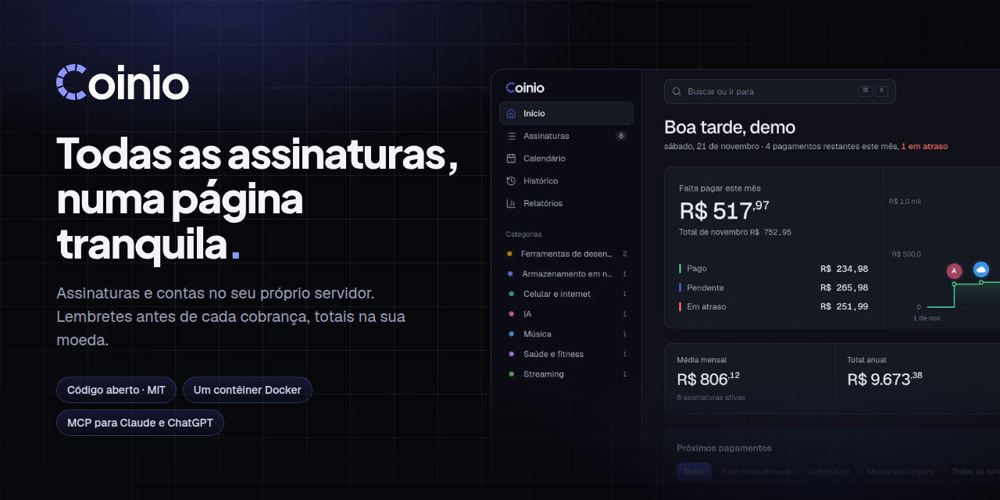
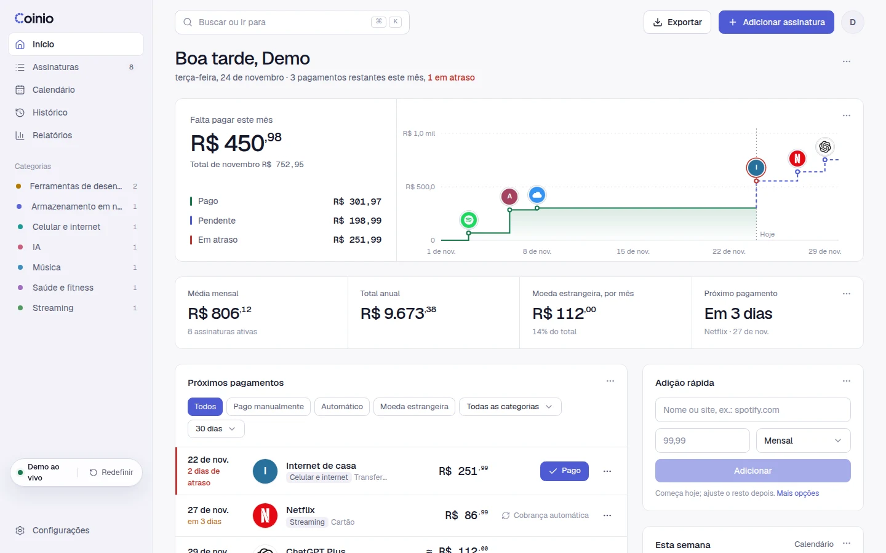
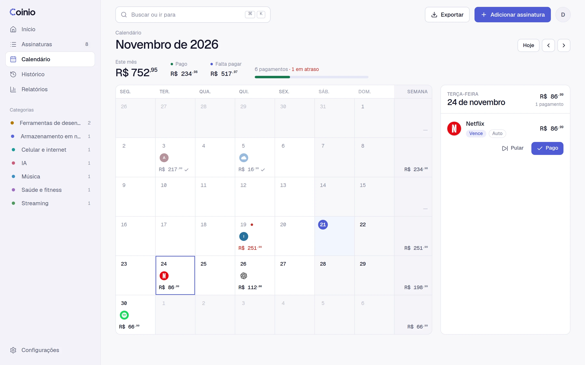
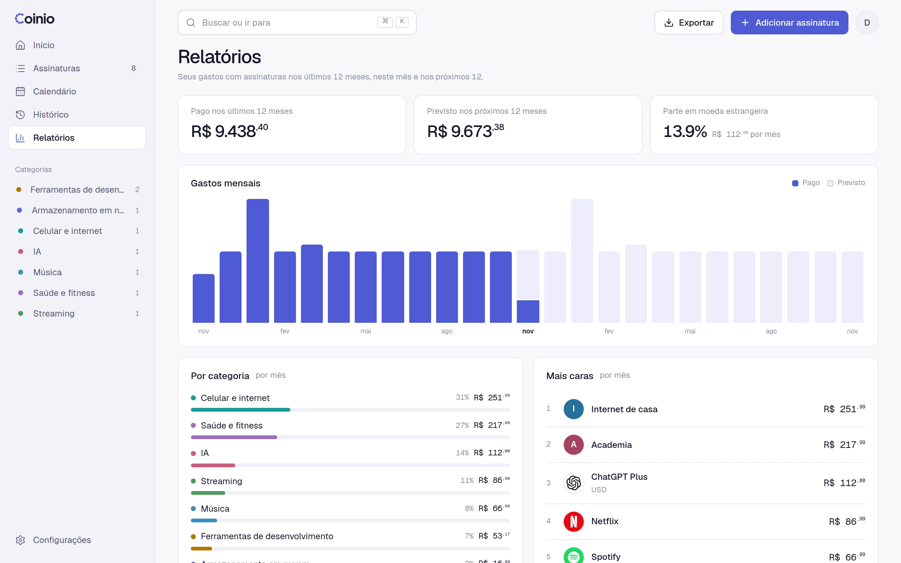
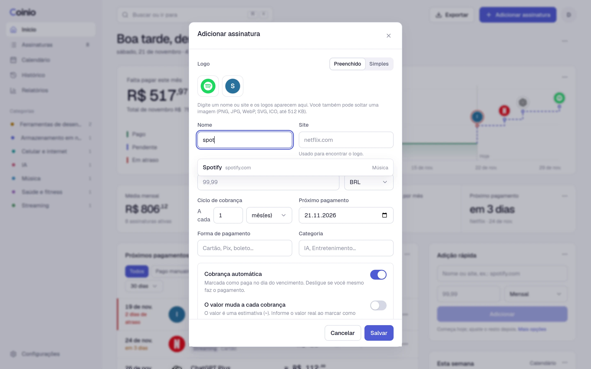
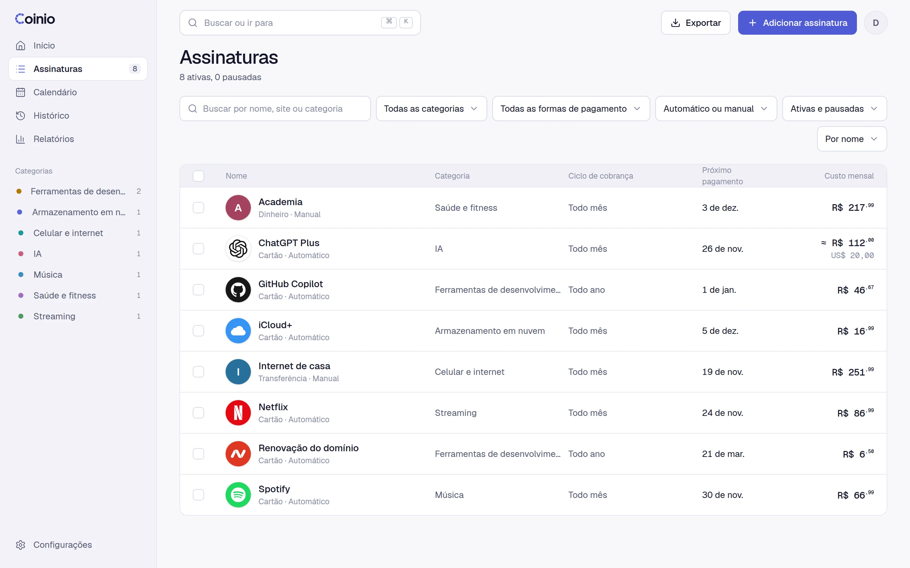
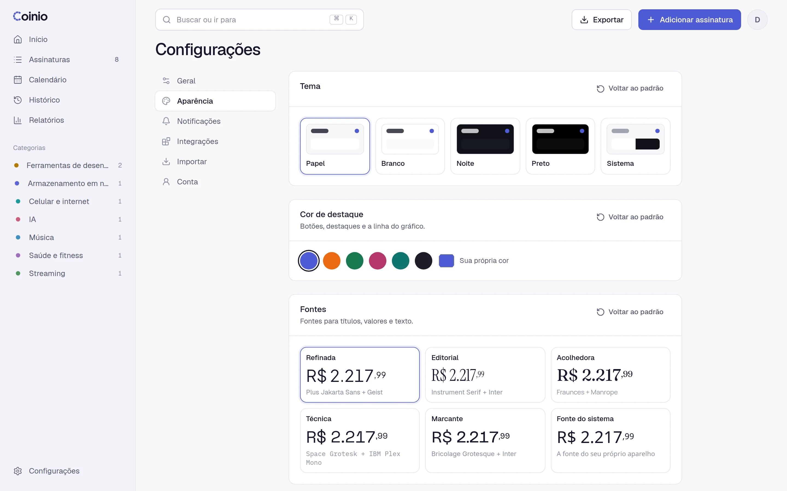
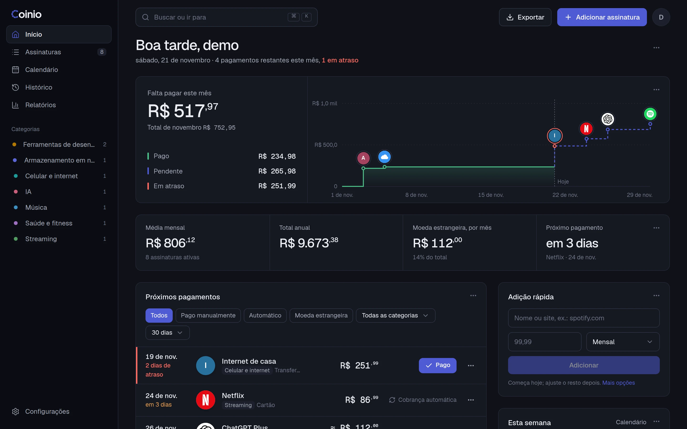
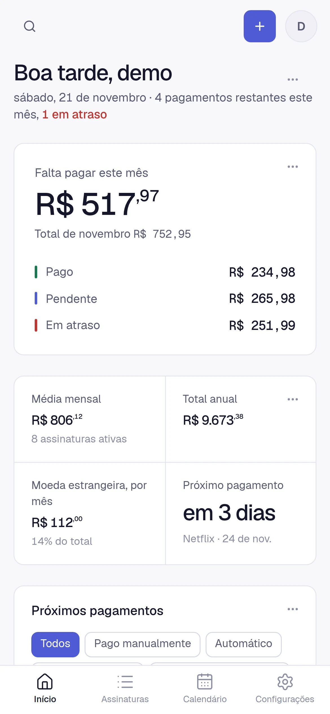

# Coinio

Um controle de assinaturas e contas auto-hospedado: um contêiner Docker, uma pasta de dados, o seu servidor.

[](https://github.com/yakupemreyerli/coinio/actions/workflows/ci.yml)
[](LICENSE)
[](https://github.com/yakupemreyerli/coinio/pkgs/container/coinio)

[English](README.md) · [Türkçe](README.tr.md) · [Deutsch](README.de.md) · [Français](README.fr.md) · [Español](README.es.md) · **Português (Brasil)** · [简体中文](README.zh-CN.md) · [日本語](README.ja.md)

[Site](https://getcoinio.me) · [Documentação](https://docs.getcoinio.me) · [Demo ao vivo](https://getcoinio.me/demo/)



O Coinio reúne todos os pagamentos recorrentes numa página só: streaming, armazenamento na nuvem, academia, aluguel, o domínio que você renova uma vez por ano. Você vê o que vence esta semana, quanto ainda falta pagar neste mês e quanto o ano inteiro custa, tudo convertido para a sua moeda principal. Não há conta no servidor de ninguém, nem telemetria, nem plano pago.

**Experimente primeiro:** a [demo ao vivo](https://getcoinio.me/demo/) é o app web de verdade rodando no seu navegador, com dados de exemplo. Nada é enviado para lugar nenhum, e você pode reiniciar quando quiser.

## Capturas de tela

<table>
  <tr>
    <td width="50%"><br><sub>Início: o que falta pagar neste mês e o que vence a seguir</sub></td>
    <td width="50%"><br><sub>Calendário: dias de pagamento e totais semanais</sub></td>
  </tr>
  <tr>
    <td width="50%"><br><sub>Relatórios: 12 meses para trás, 12 meses para a frente</sub></td>
    <td width="50%"><br><sub>Digite “spot” e o Spotify se preenche sozinho</sub></td>
  </tr>
</table>

<details>
<summary>Mais capturas de tela</summary>
<br>
<table>
  <tr>
    <td width="50%"><br><sub>Todas as assinaturas num relance</sub></td>
    <td width="50%"><br><sub>Temas, cor de destaque e fontes</sub></td>
  </tr>
  <tr>
    <td width="50%"><br><sub>Tema noturno</sub></td>
    <td width="50%"><br><sub>No celular, instalável como app web</sub></td>
  </tr>
</table>
</details>

## Recursos

- **Ciclos de cobrança de verdade.** Semanal, mensal ou anual, a cada N ciclos, cobrado automaticamente ou pago na mão. Marque um pagamento como pago, pule um período ou pause uma assinatura; o histórico fica.
- **161 serviços prontos.** Digite "spot" e o Spotify aparece com logo, categoria e ciclo. Qualquer outro site ganha o próprio ícone.
- **Calendário e lembretes.** Dias de pagamento com meses de antecedência. Lembretes, resumos e alertas de teste grátis, orçamento e preço por e-mail, Telegram, Discord, Slack, ntfy, Gotify, Pushover, webhooks ou Apprise, com modelos editáveis.
- **Qualquer moeda.** Cada assinatura mantém a própria moeda; os totais são convertidos com as cotações diárias.
- **Histórico e relatórios.** O que você pagou nos últimos 12 meses e o que esperar nos próximos 12, por categoria.
- **Importação e exportação.** Traga suas assinaturas do Wallos; exporte assinaturas e pagamentos em CSV ou JSON.
- **Assistentes de IA (MCP).** Um servidor MCP integrado, com OAuth, para que o Claude, o ChatGPT e outros clientes MCP possam ler e atualizar suas assinaturas.
- **Widget para iPhone.** Widgets para a Tela de Início e a Tela Bloqueada pelo Scriptable, sem precisar de app da App Store.
- **Do seu jeito.** Temas, cor de destaque, fontes, densidade, cards do painel, CSS próprio e cards HTML em sandbox.
- **Oito idiomas:** inglês, turco, alemão, francês, espanhol, português do Brasil, chinês simplificado e japonês. Instalável como app web.

## Instalação

Todos os métodos usam a mesma imagem, `ghcr.io/yakupemreyerli/coinio:latest` (amd64 e arm64). O app escuta na porta **8080** e guarda todos os dados em **`/data`**. Depois, abra `http://seu-servidor:8080` e crie sua conta.

**Script de instalação:** verifica se o Docker está instalado, sobe o Coinio na porta 8080 e oferece um Cloudflare Tunnel para ter https ([leia o script](site/install.sh)).

```sh
curl -fsSL https://getcoinio.me/install | sh
```

**Docker:**

```sh
docker run -d --name coinio --restart unless-stopped \
  -p 8080:8080 -v coinio-data:/data \
  ghcr.io/yakupemreyerli/coinio:latest
```

**Docker Compose:** os dados ficam em `./data`, ao lado do arquivo; as configurações opcionais vão num arquivo `.env`.

```sh
mkdir coinio && cd coinio
curl -fsSLO https://raw.githubusercontent.com/yakupemreyerli/coinio/main/docker-compose.yml
docker compose up -d
```

**Plataformas:**

| Plataforma | Como |
| --- | --- |
| Unraid | Template [`deploy/unraid/coinio.xml`](deploy/unraid/coinio.xml) · [guia](https://docs.getcoinio.me/docs/installation/unraid) |
| CasaOS | Arquivo Compose [`deploy/casaos/docker-compose.yml`](deploy/casaos/docker-compose.yml) · [guia](https://docs.getcoinio.me/docs/installation/casaos) |
| Portainer | Template de app [`deploy/portainer/template.json`](deploy/portainer/template.json) · [guia](https://docs.getcoinio.me/docs/installation/portainer) |
| Dokploy | Serviço Compose a partir deste repositório, `./docker-compose.yml` · [guia](https://docs.getcoinio.me/docs/installation/dokploy) |

Veja [deploy/README.md](deploy/README.md) e a [documentação de instalação](https://docs.getcoinio.me/docs/installation) para mais detalhes.

## Configuração

O Coinio é configurado por variáveis de ambiente. Todo o resto (moeda, fuso horário, idioma, horário dos lembretes, aparência) é definido no app e fica salvo no banco de dados. Uma variável vazia conta como não definida. Há um ponto de partida em [`.env.example`](.env.example).

| Variável | Padrão | O que faz |
| --- | --- | --- |
| `COINIO_PUBLIC_URL` | não definida | O endereço pelo qual você acessa o Coinio, por exemplo `https://coinio.example.com`. Ativa o OAuth para clientes MCP remotos e os cookies de sessão seguros. Precisa ser `https://` (ou `http://localhost`); com um endereço `http://` simples, o OAuth continua desligado. |
| `COINIO_TELEGRAM_BOT_TOKEN` | não definida | Token do bot do Telegram. Junto com o ID do chat, cria um canal do Telegram na primeira inicialização; depois, gerencie-o em **Configurações › Notificações**. |
| `COINIO_TELEGRAM_CHAT_ID` | não definida | ID do chat do Telegram para esse canal. |
| `COINIO_TELEGRAM_THREAD_ID` | não definida | ID opcional de um tópico num grupo com fóruns. |
| `PORT` | `8080` | Porta em que o servidor escuta dentro do contêiner. |
| `COINIO_DATA_DIR` | `/data` | Pasta do banco de dados (`coinio.db`) e dos logos (`logos/`). |
| `COINIO_WEB_DIR` | integrada | Pasta com o app web já compilado; só serve em desenvolvimento. |
| `TZ` | `UTC` | Fuso horário do contêiner; defina o seu, por exemplo `America/Sao_Paulo`. O fuso que "hoje", os pagamentos automáticos e os lembretes seguem é escolhido no app (**Configurações › Geral**). |

No Docker, deixe `PORT` e `COINIO_DATA_DIR` como estão: publique outra porta (`-p 9000:8080`) ou monte outra pasta em `/data`. O contêiner roda como o usuário `node` (UID 1000), então a pasta montada precisa ser gravável por ele; ao iniciar, o entrypoint assume o controle de pastas que pertencem ao root. Referência completa: [docs.getcoinio.me/docs/reference/configuration](https://docs.getcoinio.me/docs/reference/configuration).

## HTTPS e acesso remoto

Na rede de casa ou numa VPN, `http://<ip-do-servidor>:8080` basta. O widget para iPhone (fora de casa) e os conectores do claude.ai / ChatGPT precisam de um endereço **https** público:

- **Cloudflare Tunnel:** o script de instalação pede um token de túnel e inicia o `cloudflared` ao lado do Coinio, então você tem https sem abrir nenhuma porta.
- **Proxy reverso:** se você já usa Caddy, Traefik, Nginx ou Dokploy, aponte um domínio para a porta 8080.

Nos dois casos, defina `COINIO_PUBLIC_URL` com esse endereço https. Veja [Expose to the internet](https://docs.getcoinio.me/docs/expose).

## Assistentes de IA (MCP)

O servidor MCP fica no endereço do seu Coinio mais `/mcp`. Apps na nuvem, como o claude.ai e o ChatGPT, entram com OAuth (exige `COINIO_PUBLIC_URL` em https); ferramentas na sua própria máquina usam uma chave de API de **Configurações › Integrações › Chaves de API**. Em **Configurações › Integrações** há trechos prontos para copiar. Guia: [docs.getcoinio.me/docs/integrations/mcp](https://docs.getcoinio.me/docs/integrations/mcp).

## Widget para iPhone

[`widget/coinio-widget.js`](widget/coinio-widget.js) é um script do [Scriptable](https://scriptable.app) para widgets pequenos, médios e grandes da Tela de Início e widgets da Tela Bloqueada. Crie uma chave de API somente leitura, cole o script e preencha `SERVER_URL` e `API_KEY`. Guia: [docs.getcoinio.me/docs/integrations/iphone-widget](https://docs.getcoinio.me/docs/integrations/iphone-widget).

## Atualização

As migrações do banco de dados rodam sozinhas quando uma nova versão inicia.

```sh
# Compose
docker compose pull && docker compose up -d

# docker run: baixe a imagem, remova o contêiner e suba de novo com o mesmo comando
docker pull ghcr.io/yakupemreyerli/coinio:latest
docker rm -f coinio
docker run -d --name coinio --restart unless-stopped \
  -p 8080:8080 -v coinio-data:/data \
  ghcr.io/yakupemreyerli/coinio:latest
```

Se você instalou com o script, rode o script de novo em vez do último comando.

## Backups

Tudo fica em `/data`: o banco SQLite (`coinio.db`, modo WAL) e os logos. Faça backup dessa pasta e você tem tudo. Com o script de instalação ou o `docker run`, o volume se chama `coinio-data`:

```sh
docker stop coinio
docker run --rm -v coinio-data:/data -v "$PWD":/backup alpine \
  tar czf /backup/coinio-backup.tar.gz -C /data .
docker start coinio
```

Com o Compose, arquive a pasta `./data` com o contêiner parado. O backup contém chaves de API, tokens de notificação e sessões, então guarde-o como uma senha. Você também pode exportar assinaturas e pagamentos em CSV ou JSON pelo app. Passos para restaurar: [docs.getcoinio.me/docs/maintenance](https://docs.getcoinio.me/docs/maintenance).

## Desenvolvimento

Requer Node.js 22 e pnpm 12.

```sh
pnpm install
pnpm dev          # web em http://localhost:4660, API em :4661, dados em ./.data
pnpm test         # Vitest: servidor e web
pnpm typecheck
pnpm build        # dist/server e dist/web
pnpm build:demo   # demo que roda só no navegador, em site/demo/
```

O site de documentação é um pacote separado: `cd docs-site && pnpm install && pnpm dev`. Veja [CONTRIBUTING.md](CONTRIBUTING.md) para o resto.

## Estrutura do projeto

```text
src/server/     API Express, SQLite (Drizzle), autenticação, OAuth, servidor MCP, agendador, serviços
src/web/        App web React + Vite (rotas, cards do painel, configurações, i18n, backend da demo)
src/shared/     Lógica comum ao servidor, à web e à demo: agenda, catálogo, aparência, tipos
tests/          Testes do servidor (os testes da web ficam junto dos componentes)
widget/         Widget do Scriptable para iPhone
deploy/         Templates do Unraid, CasaOS e Portainer
site/           Página de apresentação (getcoinio.me), script de instalação e a demo compilada em site/demo/
docs-site/      Documentação (docs.getcoinio.me), Fumadocs sobre Next.js
docs/           Arquivos da marca e os banners do README
```

## Créditos

- Os logos das marcas vêm do [Simple Icons](https://simpleicons.org) (CC0-1.0). Os logos são marcas registradas de seus donos; usá-los não implica aprovação.
- Quando um serviço não tem logo no Simple Icons, o Coinio busca o ícone do próprio site, ou os serviços de favicon do Google e do DuckDuckGo.
- Cotações do [Frankfurter](https://frankfurter.dev), que publica as taxas de referência do Banco Central Europeu.
- Fontes via [Fontsource](https://fontsource.org) e Google Fonts: Geist, Geist Mono, Inter, Manrope, Space Grotesk, Bricolage Grotesque, Fraunces, Instrument Serif, IBM Plex Mono e Plus Jakarta Sans, todas sob a SIL Open Font License 1.1.
- Ícones do [Lucide](https://lucide.dev) (ISC). O site de documentação é feito com o [Fumadocs](https://fumadocs.dev).

## Licença

[MIT](LICENSE) © 2026 Yakup Emre Yerli
