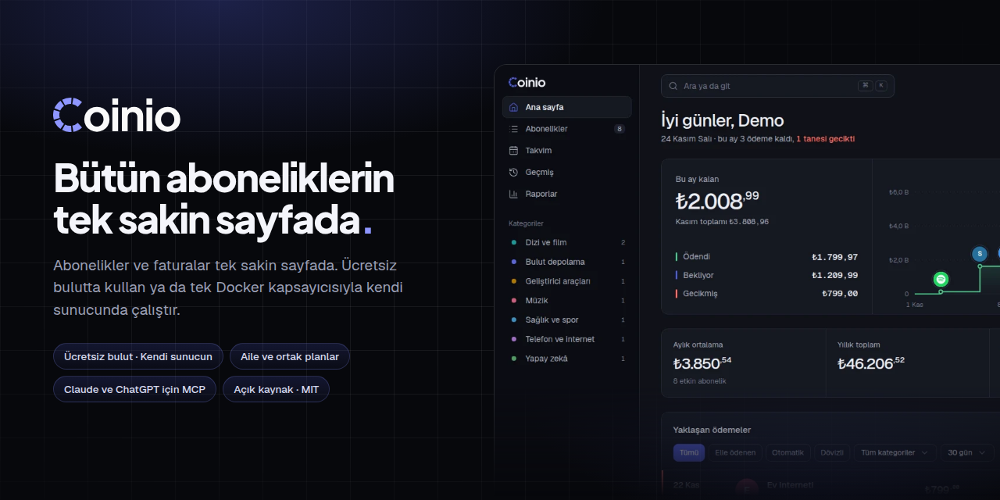

# Coinio

Kendi sunucunda çalışan abonelik ve fatura takibi: tek Docker kapsayıcısı, tek veri klasörü.

[](https://github.com/yakupemreyerli/coinio/actions/workflows/ci.yml)
[](LICENSE)
[](https://github.com/yakupemreyerli/coinio/pkgs/container/coinio)

[English](README.md) · [Site](https://getcoinio.me) · [Belgeler](https://docs.getcoinio.me) · [Canlı demo](https://getcoinio.me/demo/)



Coinio düzenli ödediğin her şeyi tek sayfada toplar: dizi platformu, bulut depolama, spor salonu, kira, yılda bir yenilediğin alan adı. Bu hafta neyin çekileceğini, bu ay ne kadar ödemen kaldığını ve bütün yılın sana kaça patladığını kendi para biriminde görürsün. Başkasının sunucusunda hesap açmazsın; telemetri ve ücretli sürüm de yok.

**Önce dene:** [canlı demo](https://getcoinio.me/demo/) gerçek web uygulamasının tarayıcında örnek veriyle çalışan hâli. Hiçbir yere veri gitmez, istediğin an sıfırlarsın.

## Özellikler

- **Gerçek ödeme dönemleri.** Haftalık, aylık, yıllık ya da her N dönemde bir; otomatik çekilen ya da elle ödenen. Ödemeyi ödendi diye işaretle, bir dönemi atla ya da aboneliği duraklat; geçmiş silinmez.
- **161 hazır servis.** "spot" yazınca Spotify logosu, kategorisi ve dönemiyle gelir. Listede olmayan sitenin kendi ikonu bulunur.
- **Takvim ve hatırlatma.** Ödeme günlerini aylar öncesinden görürsün; her gün Telegram'dan yaklaşan ve geciken ödemeler için mesaj gelir.
- **Her para birimi.** Her abonelik kendi para biriminde kalır, toplamlar günlük kurla çevrilir.
- **Geçmiş ve raporlar.** Son 12 ayda ne ödediğin, önümüzdeki 12 ayda ne bekleyeceğin, kategoriye göre.
- **İçe ve dışa aktarma.** Wallos'taki aboneliklerini taşı; abonelikleri ve ödemeleri CSV ya da JSON olarak indir.
- **Yapay zekâ asistanları (MCP).** OAuth destekli yerleşik MCP sunucusu sayesinde Claude, ChatGPT ve başka MCP istemcileri aboneliklerini okuyup güncelleyebilir.
- **iPhone widget'ı.** Scriptable ile ana ekran ve kilit ekranı widget'ları; App Store uygulaması gerekmez.
- **Kendi görünüşün.** Tema, vurgu rengi, yazı tipi, sıklık, ana sayfa kartları, özel CSS ve korumalı alanda çalışan HTML kartları.
- **Sekiz dil:** Türkçe, İngilizce, Almanca, Fransızca, İspanyolca, Brezilya Portekizcesi, Basitleştirilmiş Çince ve Japonca. Web uygulaması olarak ana ekrana eklenebilir.

## Kurulum

Bütün yöntemler aynı imajı çalıştırır: `ghcr.io/yakupemreyerli/coinio:latest` (amd64 ve arm64). Uygulama **8080** portunu dinler, bütün verisini **`/data`** klasöründe tutar. Kurduktan sonra `http://sunucun:8080` adresini açıp hesabını oluştur.

**Kurulum betiği:** Docker'ın kurulu olduğunu kontrol eder, Coinio'yu 8080 portunda başlatır ve https için Cloudflare Tunnel kurmayı önerir ([betiği oku](site/install.sh)).

```sh
curl -fsSL https://getcoinio.me/install | sh
```

**Docker:**

```sh
docker run -d --name coinio --restart unless-stopped \
  -p 8080:8080 -v coinio-data:/data \
  ghcr.io/yakupemreyerli/coinio:latest
```

**Docker Compose:** veri, dosyanın yanındaki `./data` klasörüne yazılır; isteğe bağlı ayarlar `.env` dosyasına girer.

```sh
mkdir coinio && cd coinio
curl -fsSLO https://raw.githubusercontent.com/yakupemreyerli/coinio/main/docker-compose.yml
docker compose up -d
```

**Platformlar:**

| Platform | Nasıl |
| --- | --- |
| Unraid | Şablon [`deploy/unraid/coinio.xml`](deploy/unraid/coinio.xml) · [rehber](https://docs.getcoinio.me/docs/installation/unraid) |
| CasaOS | Compose dosyası [`deploy/casaos/docker-compose.yml`](deploy/casaos/docker-compose.yml) · [rehber](https://docs.getcoinio.me/docs/installation/casaos) |
| Portainer | Uygulama şablonu [`deploy/portainer/template.json`](deploy/portainer/template.json) · [rehber](https://docs.getcoinio.me/docs/installation/portainer) |
| Dokploy | Bu depodan Compose servisi, `./docker-compose.yml` · [rehber](https://docs.getcoinio.me/docs/installation/dokploy) |

Ayrıntılar [deploy/README.md](deploy/README.md) dosyasında ve [kurulum belgelerinde](https://docs.getcoinio.me/docs/installation). Belgeler İngilizce.

## Ayarlar

Coinio ortam değişkenleriyle ayarlanır. Geri kalan her şey (para birimi, saat dilimi, dil, hatırlatma saati, görünüş) uygulamanın içinden seçilir ve veritabanında durur. Boş bırakılan değişken hiç verilmemiş sayılır. Başlangıç için [`.env.example`](.env.example) dosyasına bak.

| Değişken | Varsayılan | Ne işe yarar |
| --- | --- | --- |
| `COINIO_PUBLIC_URL` | yok | Coinio'yu açtığın adres, örneğin `https://coinio.example.com`. Uzaktaki MCP istemcileri için OAuth'u ve güvenli oturum çerezlerini açar. `https://` (ya da `http://localhost`) olmalı; düz `http://` adreste OAuth kapalı kalır. |
| `COINIO_TELEGRAM_BOT_TOKEN` | yok | Telegram bot token'ı. **Ayarlar › Bildirimler**'de kayıtlı olanın yerine geçer. |
| `COINIO_TELEGRAM_CHAT_ID` | yok | Telegram sohbet kimliği. Uygulamada kayıtlı olanın yerine geçer. |
| `PORT` | `8080` | Sunucunun kapsayıcı içinde dinlediği port. |
| `COINIO_DATA_DIR` | `/data` | Veritabanının (`coinio.db`) ve logoların (`logos/`) klasörü. |
| `COINIO_WEB_DIR` | imajın içinde | Derlenmiş web uygulamasının klasörü; yalnız geliştirmede işe yarar. |
| `TZ` | `UTC` | Kapsayıcının saat dilimi; kendi saat dilimini yaz, örneğin `Europe/Berlin`. "Bugün", otomatik ödemeler ve hatırlatmalar uygulamada seçtiğin saat dilimine göre işler (**Ayarlar › Genel**). |

Docker'da `PORT` ve `COINIO_DATA_DIR` ile oynama: başka bir port istiyorsan dışarıya onu aç (`-p 9000:8080`), veriyi başka yerde tutmak istiyorsan `/data`'ya başka bir klasör bağla. Kapsayıcı `node` kullanıcısıyla (UID 1000) çalışır, bağladığın klasöre bu kullanıcı yazabilmeli; root'a ait klasörleri başlangıçta kendisi devralır. Tam liste: [docs.getcoinio.me/docs/reference/configuration](https://docs.getcoinio.me/docs/reference/configuration).

## HTTPS ve dışarıdan erişim

Ev ağında ya da VPN üzerinden `http://<sunucu-ip>:8080` yeter. Evden uzaktayken iPhone widget'ı ve claude.ai / ChatGPT bağlayıcıları için herkese açık bir **https** adresi gerekir:

- **Cloudflare Tunnel:** kurulum betiği tünel token'ını sorar ve Coinio'nun yanında `cloudflared` başlatır; hiçbir port açmadan https adresin olur.
- **Ters vekil sunucu:** zaten Caddy, Traefik, Nginx ya da Dokploy kullanıyorsan bir alan adını 8080 portuna yönlendir.

İki durumda da `COINIO_PUBLIC_URL` değişkenine bu https adresini yaz. Ayrıntı: [Expose to the internet](https://docs.getcoinio.me/docs/expose).

## Yapay zekâ asistanları (MCP)

MCP sunucusu Coinio adresinin sonuna `/mcp` eklenerek bulunur. claude.ai ve ChatGPT gibi bulut uygulamaları OAuth ile giriş yapar (https'li `COINIO_PUBLIC_URL` gerekir); kendi bilgisayarındaki araçlar **Ayarlar › Entegrasyonlar › API anahtarları**'ndan alınan anahtarı kullanır. **Ayarlar › Entegrasyonlar** hazır kod parçalarını gösterir. Rehber: [docs.getcoinio.me/docs/integrations/mcp](https://docs.getcoinio.me/docs/integrations/mcp).

## iPhone widget'ı

[`widget/coinio-widget.js`](widget/coinio-widget.js), küçük, orta ve büyük ana ekran widget'ları ile kilit ekranı widget'ları için bir [Scriptable](https://scriptable.app) betiği. Salt okunur bir API anahtarı oluştur, betiği yapıştır, `SERVER_URL` ve `API_KEY` satırlarını doldur. Rehber: [docs.getcoinio.me/docs/integrations/iphone-widget](https://docs.getcoinio.me/docs/integrations/iphone-widget).

## Güncelleme

Yeni sürüm açılırken veritabanı geçişleri kendiliğinden çalışır.

```sh
# Compose
docker compose pull && docker compose up -d

# docker run: imajı çek, kapsayıcıyı sil, aynı komutla yeniden başlat
docker pull ghcr.io/yakupemreyerli/coinio:latest
docker rm -f coinio
docker run -d --name coinio --restart unless-stopped \
  -p 8080:8080 -v coinio-data:/data \
  ghcr.io/yakupemreyerli/coinio:latest
```

Kurulum betiğiyle kurduysan son komut yerine betiği yeniden çalıştır.

## Yedekleme

Her şey `/data` klasöründe: SQLite veritabanı (`coinio.db`, WAL kipi) ve logolar. Bu klasörü yedeklersen hepsini yedeklemiş olursun. Kurulum betiği ya da `docker run` ile kurduysan birimin adı `coinio-data`:

```sh
docker stop coinio
docker run --rm -v coinio-data:/data -v "$PWD":/backup alpine \
  tar czf /backup/coinio-backup.tar.gz -C /data .
docker start coinio
```

Compose'da kapsayıcı dururken `./data` klasörünü arşivle. Yedekte API anahtarları, Telegram token'ı ve oturumlar da var; onu parola gibi sakla. Abonelikleri ve ödemeleri uygulamadan CSV ya da JSON olarak da indirebilirsin. Geri yükleme: [docs.getcoinio.me/docs/maintenance](https://docs.getcoinio.me/docs/maintenance).

## Geliştirme

Node.js 22 ve pnpm 12 gerekir.

```sh
pnpm install
pnpm dev          # web http://localhost:4660, API :4661, veri ./.data
pnpm test         # Vitest: sunucu ve web
pnpm typecheck
pnpm build        # dist/server ve dist/web
pnpm build:demo   # tarayıcıda çalışan demoyu site/demo/ içine derler
```

Belge sitesi ayrı bir paket: `cd docs-site && pnpm install && pnpm dev`. Gerisi [CONTRIBUTING.md](CONTRIBUTING.md) dosyasında (İngilizce).

## Proje yapısı

```text
src/server/     Express API, SQLite (Drizzle), oturum, OAuth, MCP sunucusu, zamanlayıcı, servisler
src/web/        React + Vite web uygulaması (sayfalar, ana sayfa kartları, ayarlar, i18n, demo arka ucu)
src/shared/     Sunucu, web ve demonun ortak mantığı: ödeme takvimi, katalog, görünüş, tipler
tests/          Sunucu testleri (web testleri bileşenlerin yanında)
widget/         Scriptable iPhone widget'ı
deploy/         Unraid, CasaOS ve Portainer şablonları
site/           Tanıtım sitesi (getcoinio.me), kurulum betiği ve site/demo/ içindeki derlenmiş demo
docs-site/      Belgeler (docs.getcoinio.me), Next.js üzerinde Fumadocs
docs/           Marka dosyaları ve README görselleri
```

## Teşekkürler

- Marka logoları [Simple Icons](https://simpleicons.org)'tan (CC0-1.0). Logolar sahiplerinin ticari markalarıdır; kullanılmaları bir onay anlamına gelmez.
- Simple Icons'ta logosu olmayan servis için Coinio sitenin kendi ikonunu ya da Google ve DuckDuckGo'nun favicon servislerini kullanır.
- Döviz kurları, Avrupa Merkez Bankası'nın referans kurlarını yayımlayan [Frankfurter](https://frankfurter.dev)'dan.
- Yazı tipleri [Fontsource](https://fontsource.org) ve Google Fonts üzerinden: Geist, Geist Mono, Inter, Manrope, Space Grotesk, Bricolage Grotesque, Fraunces, Instrument Serif, IBM Plex Mono ve Plus Jakarta Sans; hepsi SIL Open Font License 1.1 ile.
- İkonlar [Lucide](https://lucide.dev)'dan (ISC). Belge sitesi [Fumadocs](https://fumadocs.dev) ile yapıldı.

## Lisans

[MIT](LICENSE) © 2026 Yakup Emre Yerli
