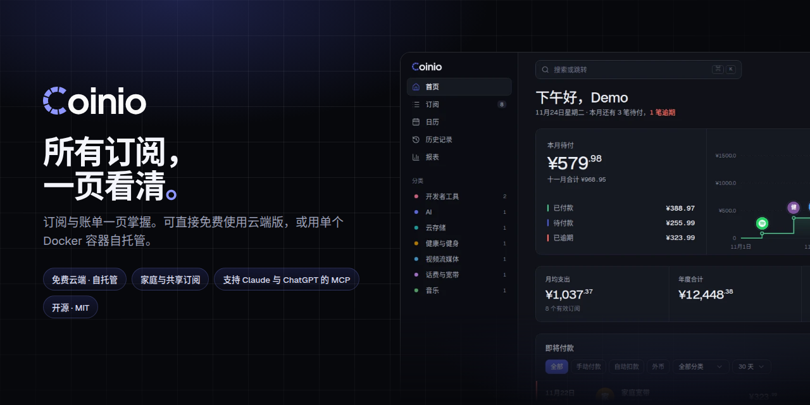
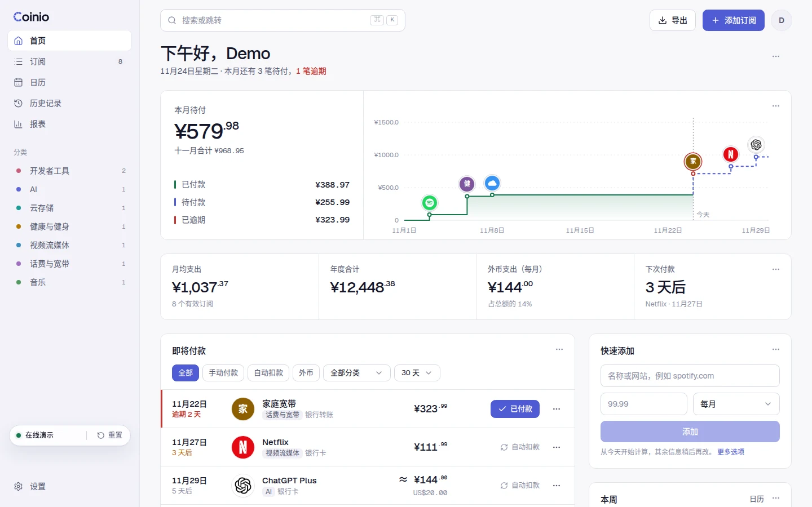
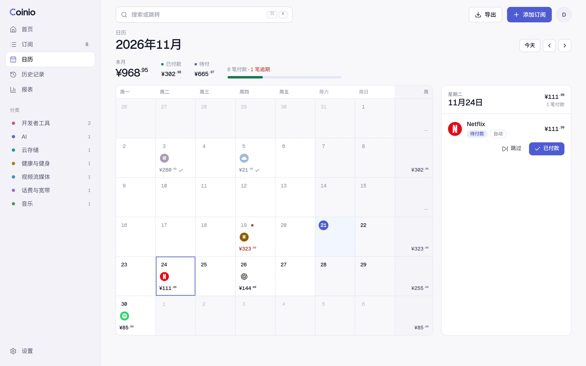
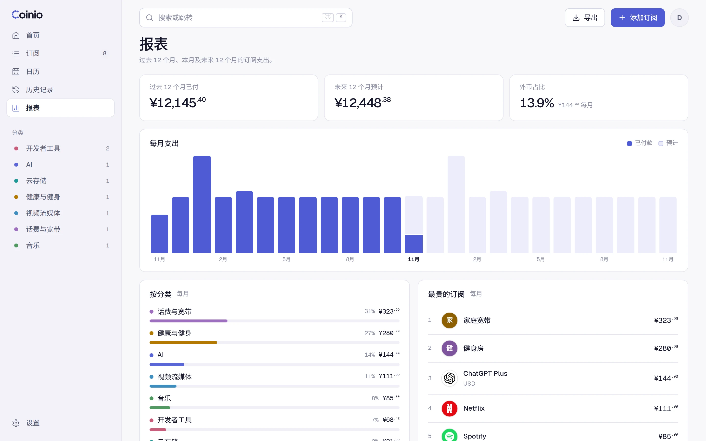
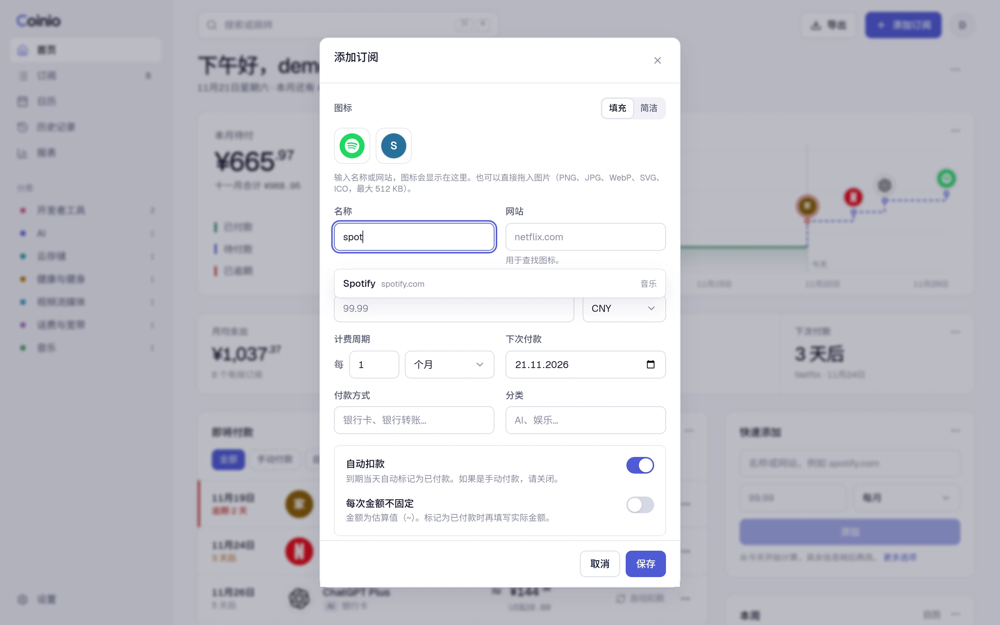
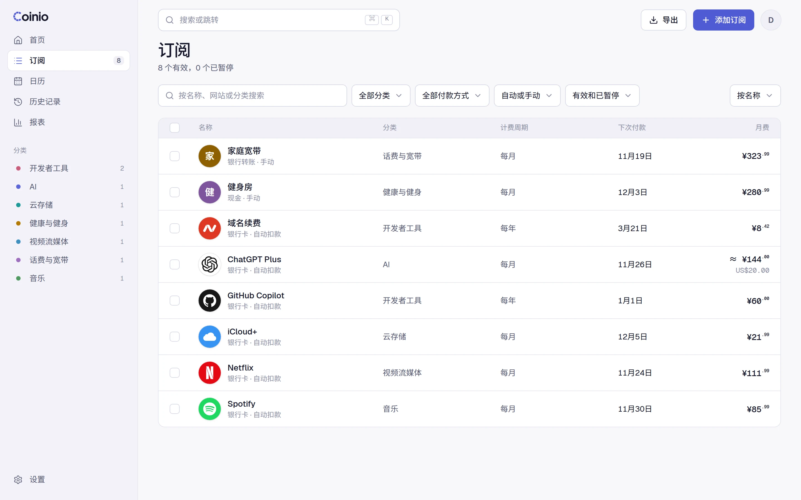
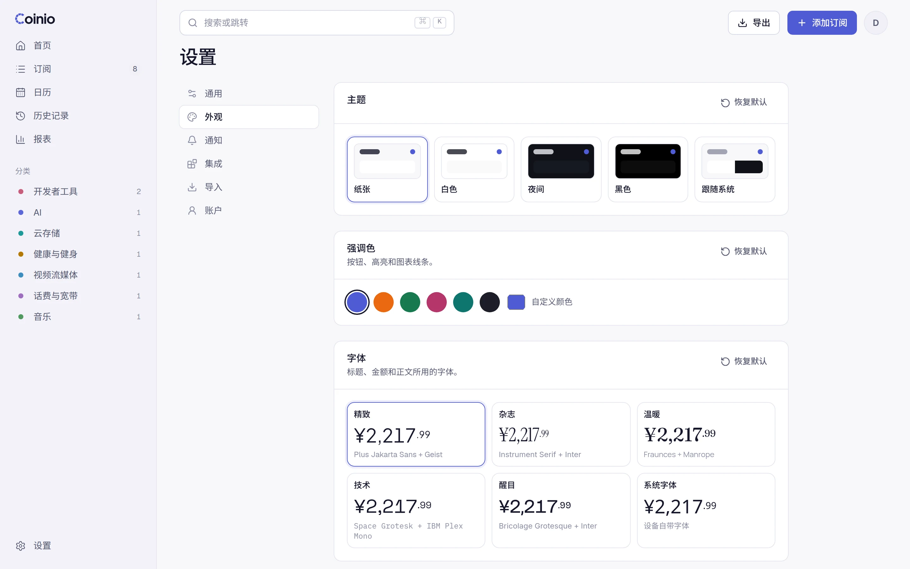
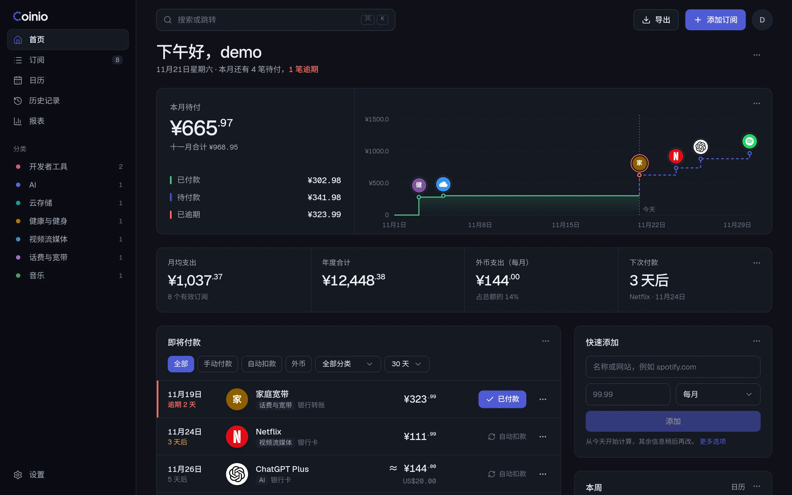
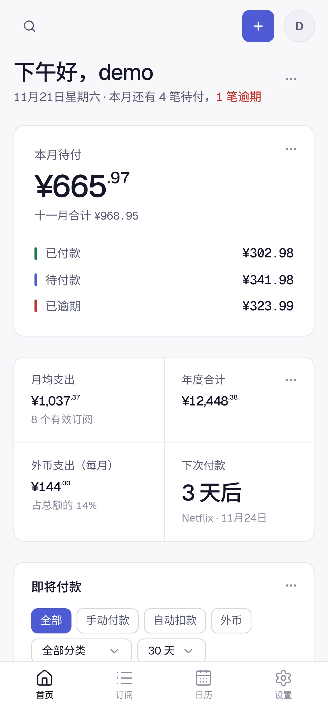

# Coinio

自托管的订阅与账单管理工具：一个 Docker 容器，一个数据文件夹，运行在你自己的服务器上。

[](https://github.com/yakupemreyerli/coinio/actions/workflows/ci.yml)
[](LICENSE)
[](https://github.com/yakupemreyerli/coinio/pkgs/container/coinio)

[English](README.md) · [Türkçe](README.tr.md) · [Deutsch](README.de.md) · [Français](README.fr.md) · [Español](README.es.md) · [Português (Brasil)](README.pt-BR.md) · **简体中文** · [日本語](README.ja.md)

[网站](https://getcoinio.me) · [文档](https://docs.getcoinio.me) · [在线演示](https://getcoinio.me/demo/) · [免费使用](https://app.getcoinio.me/signup)



Coinio 把所有周期性付款放在同一个页面：流媒体、云存储、健身房、房租，还有一年续费一次的域名。本周有哪些要扣款、本月还剩多少没付、全年一共要花多少钱，都会按汇率换算成你的主币种，一目了然。无需在别人的服务器上注册账户，没有遥测，也没有付费版。

**先试试看**：[在线演示](https://getcoinio.me/demo/)就是真正的 Web 应用，在浏览器中使用示例数据运行。不会向任何地方发送数据，也可以随时重置。

**不想自己部署？** 在 [app.getcoinio.me](https://app.getcoinio.me/signup) 免费使用 Coinio：同一个应用，没有广告和跟踪。[了解更多](https://docs.getcoinio.me/docs/hosted)

## 截图

<table>
  <tr>
    <td width="50%"><br><sub>首页：本月还剩多少要付，下一笔是什么</sub></td>
    <td width="50%"><br><sub>日历：付款日与每周合计</sub></td>
  </tr>
  <tr>
    <td width="50%"><br><sub>报表：回看 12 个月，展望 12 个月</sub></td>
    <td width="50%"><br><sub>输入“spot”，Spotify 自动填好</sub></td>
  </tr>
</table>

<details>
<summary>更多截图</summary>
<br>
<table>
  <tr>
    <td width="50%"><br><sub>所有订阅，一目了然</sub></td>
    <td width="50%"><br><sub>主题、强调色和字体</sub></td>
  </tr>
  <tr>
    <td width="50%"><br><sub>夜间主题</sub></td>
    <td width="50%"><br><sub>在手机上使用，可安装为 Web 应用</sub></td>
  </tr>
</table>
</details>

## 功能

- **真实的计费周期。** 每周、每月或每年，每隔 N 个周期，自动扣款或手动支付。可以把一笔付款标记为已付款、跳过某个周期或暂停订阅，历史记录都会保留。
- **内置 161 个服务。** 输入“spot”，Spotify 的图标、分类和计费周期就会自动填好。其他网站则使用它自己的图标。
- **日历与提醒。** 提前数月查看付款日。提醒、汇总，以及试用期、预算和价格提醒，可通过电子邮件、Telegram、Discord、Slack、ntfy、Gotify、Pushover、Webhook 或 Apprise 发送，模板可自行编辑。
- **任意币种。** 每个订阅保留自己的币种，合计金额按每日汇率换算。
- **历史与报表。** 按分类查看过去 12 个月付了多少，以及未来 12 个月预计支出。
- **导入与导出。** 从 Wallos 迁移订阅；订阅和付款记录可导出为 CSV 或 JSON。
- **Firefly III。** 与你自己的 [Firefly III](https://docs.getcoinio.me/docs/integrations/firefly) 双向同步：订阅对应账单（bill），付款记录双向传递。
- **AI 助手（MCP）。** 内置支持 OAuth 的 MCP 服务器，Claude、ChatGPT 和其他 MCP 客户端可以读取并更新你的订阅。
- **iPhone 小组件。** 通过 Scriptable 提供主屏幕和锁定屏幕小组件，无需安装 App Store 应用。
- **自定义外观。** 主题、强调色、字体、密度、仪表盘卡片、自定义 CSS 和沙盒化的 HTML 卡片。
- **八种语言**：英语、土耳其语、德语、法语、西班牙语、巴西葡萄牙语、简体中文和日语。可安装为 Web 应用。

## 安装

所有方式运行的都是同一个镜像：`ghcr.io/yakupemreyerli/coinio:latest`（amd64 和 arm64）。应用监听 **8080** 端口，所有数据都保存在 **`/data`**。安装完成后，打开 `http://你的服务器:8080` 并创建账户。

**安装脚本**：检查 Docker，在 8080 端口启动 Coinio，并可选用 Cloudflare Tunnel 提供 https 访问（[查看脚本](site/install.sh)）。

```sh
curl -fsSL https://getcoinio.me/install | sh
```

**Docker**：

```sh
docker run -d --name coinio --restart unless-stopped \
  -p 8080:8080 -v coinio-data:/data \
  ghcr.io/yakupemreyerli/coinio:latest
```

**Docker Compose**：数据保存在文件旁的 `./data`；可选设置写在 `.env` 文件中。

```sh
mkdir coinio && cd coinio
curl -fsSLO https://raw.githubusercontent.com/yakupemreyerli/coinio/main/docker-compose.yml
docker compose up -d
```

**平台**：

| 平台 | 方式 |
| --- | --- |
| Unraid | 模板 [`deploy/unraid/coinio.xml`](deploy/unraid/coinio.xml) · [指南](https://docs.getcoinio.me/docs/installation/unraid) |
| CasaOS | Compose 文件 [`deploy/casaos/docker-compose.yml`](deploy/casaos/docker-compose.yml) · [指南](https://docs.getcoinio.me/docs/installation/casaos) |
| Portainer | 应用模板 [`deploy/portainer/template.json`](deploy/portainer/template.json) · [指南](https://docs.getcoinio.me/docs/installation/portainer) |
| Dokploy | 基于本仓库的 Compose 服务，`./docker-compose.yml` · [指南](https://docs.getcoinio.me/docs/installation/dokploy) |

详情请见 [deploy/README.md](deploy/README.md) 和[安装文档](https://docs.getcoinio.me/docs/installation)。

## 配置

Coinio 通过环境变量配置。其余所有设置（币种、时区、语言、提醒时间、外观）都在应用内设置，并保存在数据库中。空变量视为未设置。起步可参考 [`.env.example`](.env.example)。

| 变量 | 默认值 | 作用 |
| --- | --- | --- |
| `COINIO_PUBLIC_URL` | 未设置 | 你访问 Coinio 所用的地址，例如 `https://coinio.example.com`。为远程 MCP 客户端启用 OAuth，并启用安全会话 Cookie。必须是 `https://`（或 `http://localhost`）；使用普通 `http://` 地址时，OAuth 保持关闭。 |
| `COINIO_TELEGRAM_BOT_TOKEN` | 未设置 | Telegram 机器人令牌。与聊天 ID 一起使用时，会在首次启动时创建一个 Telegram 渠道；之后在 **设置 › 通知** 中管理。 |
| `COINIO_TELEGRAM_CHAT_ID` | 未设置 | 该渠道使用的 Telegram 聊天 ID。 |
| `COINIO_TELEGRAM_THREAD_ID` | 未设置 | 可选，论坛群组中的话题 ID。 |
| `PORT` | `8080` | 服务器在容器内监听的端口。 |
| `COINIO_DATA_DIR` | `/data` | 存放数据库（`coinio.db`）和图标（`logos/`）的文件夹。 |
| `COINIO_WEB_DIR` | 内置 | 已构建 Web 应用所在的文件夹；仅在开发时有用。 |
| `TZ` | `UTC` | 容器时区；请设为你自己的时区，例如 `Asia/Shanghai`。“今天”、自动扣款和提醒所遵循的时区在应用内选择（**设置 › 通用**）。 |

在 Docker 中，请不要改动 `PORT` 和 `COINIO_DATA_DIR`：要换端口，就发布另一个端口（`-p 9000:8080`）；要换位置，就把别的文件夹挂载到 `/data`。容器以用户 `node`（UID 1000）运行，因此挂载的文件夹必须对该用户可写；入口脚本会在启动时接管属于 root 的文件夹。完整参考：[docs.getcoinio.me/docs/reference/configuration](https://docs.getcoinio.me/docs/reference/configuration)。

## HTTPS 与远程访问

在家庭网络或 VPN 中，`http://<服务器 IP>:8080` 就够用了。iPhone 小组件（不在家时）以及 claude.ai / ChatGPT 连接器需要一个公网 **https** 地址：

- **Cloudflare Tunnel**：安装脚本会询问隧道令牌，并在 Coinio 旁边启动 `cloudflared`，无需开放任何端口即可获得 https。
- **反向代理**：如果你已经在用 Caddy、Traefik、Nginx 或 Dokploy，把域名指向 8080 端口即可。

无论哪种方式，都要把 `COINIO_PUBLIC_URL` 设为这个 https 地址。参见 [Expose to the internet](https://docs.getcoinio.me/docs/expose)。

## AI 助手（MCP）

MCP 服务器位于你的 Coinio 地址加 `/mcp`。claude.ai 和 ChatGPT 等云端应用通过 OAuth 登录（需要 https 的 `COINIO_PUBLIC_URL`）；你自己电脑上的工具则使用在 **设置 › 集成 › API 密钥** 中创建的 API 密钥。**设置 › 集成** 里有现成的配置片段。指南：[docs.getcoinio.me/docs/integrations/mcp](https://docs.getcoinio.me/docs/integrations/mcp)。

## iPhone 小组件

[`widget/coinio-widget.js`](widget/coinio-widget.js) 是一个 [Scriptable](https://scriptable.app) 脚本，提供小、中、大三种主屏幕小组件以及锁定屏幕小组件。创建一个只读 API 密钥，粘贴脚本，再填写 `SERVER_URL` 和 `API_KEY`。指南：[docs.getcoinio.me/docs/integrations/iphone-widget](https://docs.getcoinio.me/docs/integrations/iphone-widget)。

**Android：** Coinio 小组件运行在免费的 [ScriptWidget](https://github.com/everettjf/scriptwidget) 应用中；“设置 › 集成 › Android 小组件”会给出要粘贴的参数。指南：[docs.getcoinio.me/docs/integrations/android-widget](https://docs.getcoinio.me/docs/integrations/android-widget)。

## Firefly III

“设置 › 集成 › Firefly III”让你的订阅与自己的 [Firefly III](https://www.firefly-iii.org) 中的账单（bill）双向保持同步，付款记录也包括在内。需要 Firefly III 的 Personal Access Token，以及 Coinio 能访问到的地址。两边都不会删除任何内容。指南：[docs.getcoinio.me/docs/integrations/firefly](https://docs.getcoinio.me/docs/integrations/firefly)。

## 更新

新版本启动时，数据库迁移会自动执行。

```sh
# Compose
docker compose pull && docker compose up -d

# docker run：拉取镜像，删除容器，再用同样的命令重新启动
docker pull ghcr.io/yakupemreyerli/coinio:latest
docker rm -f coinio
docker run -d --name coinio --restart unless-stopped \
  -p 8080:8080 -v coinio-data:/data \
  ghcr.io/yakupemreyerli/coinio:latest
```

如果你是用脚本安装的，请重新运行该脚本，而不是最后那条命令。

## 备份

所有内容都在 `/data` 中：SQLite 数据库（`coinio.db`，WAL 模式）和图标。备份这个文件夹，就备份了全部。使用安装脚本或 `docker run` 时，数据卷名为 `coinio-data`：

```sh
docker stop coinio
docker run --rm -v coinio-data:/data -v "$PWD":/backup alpine \
  tar czf /backup/coinio-backup.tar.gz -C /data .
docker start coinio
```

使用 Compose 时，请在容器停止后打包 `./data` 文件夹。备份中包含 API 密钥、通知令牌和会话，请像保管密码一样保管它。你也可以在应用中将订阅和付款记录导出为 CSV 或 JSON。恢复步骤：[docs.getcoinio.me/docs/maintenance](https://docs.getcoinio.me/docs/maintenance)。

## 开发

需要 Node.js 22 和 pnpm 12。

```sh
pnpm install
pnpm dev          # 网页在 http://localhost:4660，API 在 :4661，数据在 ./.data
pnpm test         # Vitest：服务端和网页
pnpm typecheck
pnpm build        # dist/server 和 dist/web
pnpm build:demo   # 仅在浏览器中运行的演示，输出到 site/demo/
```

文档站是一个独立的包：`cd docs-site && pnpm install && pnpm dev`。其余内容请见 [CONTRIBUTING.md](CONTRIBUTING.md)。

## 项目结构

```text
src/server/     Express API、SQLite (Drizzle)、认证、OAuth、MCP 服务器、调度器、各项服务
src/web/        React + Vite Web 应用（路由、仪表盘卡片、设置、i18n、演示后端）
src/shared/     服务端、网页和演示共用的逻辑：付款日程、目录、外观、类型
tests/          服务端测试（网页测试放在各自组件旁边）
widget/         Scriptable iPhone 小组件
deploy/         Unraid、CasaOS 和 Portainer 模板
site/           宣传页（getcoinio.me）、安装脚本和 site/demo/ 中构建好的演示
docs-site/      文档站（docs.getcoinio.me），基于 Next.js 的 Fumadocs
docs/           品牌素材和 README 横幅图
```

## 致谢

- 品牌图标来自 [Simple Icons](https://simpleicons.org)（CC0-1.0）。这些图标是其所有者的商标；使用它们并不代表获得认可。
- 如果某个服务在 Simple Icons 中没有图标，Coinio 会获取该网站自己的图标，或使用 Google 和 DuckDuckGo 的 favicon 服务。
- 汇率来自 [Frankfurter](https://frankfurter.dev)，它发布欧洲中央银行的参考汇率。
- 字体通过 [Fontsource](https://fontsource.org) 和 Google Fonts 提供：Geist、Geist Mono、Inter、Manrope、Space Grotesk、Bricolage Grotesque、Fraunces、Instrument Serif、IBM Plex Mono 和 Plus Jakarta Sans，均采用 SIL Open Font License 1.1。
- 图标来自 [Lucide](https://lucide.dev)（ISC）。文档站使用 [Fumadocs](https://fumadocs.dev) 构建。

## 许可证

[MIT](LICENSE) © 2026 Yakup Emre Yerli
